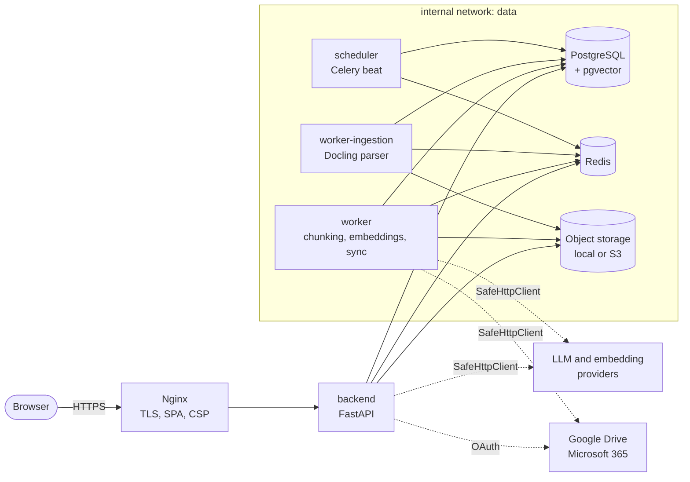
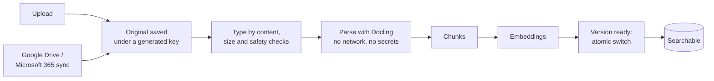
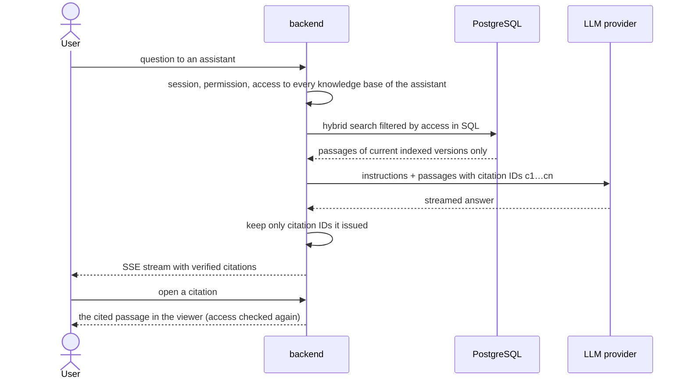

# PlummyKnowledge

[Русская версия](README.ru.md)

PlummyKnowledge is an open-source, **self-hosted** knowledge base for a company, with an AI assistant on top. It
connects document sources, indexes them, gives employees secure search and answers their questions with
**citations that the backend verifies** against the source documents.

- **Your data stays with you.** Documents, indexes, conversations and settings live only in your installation.
- **Any model.** Connect cloud or local LLMs (OpenAI, Anthropic, Ollama, any OpenAI-compatible server) and choose
  the embedding model separately.
- **Answers with verified citations.** The model can cite only the passages the backend gave it; invented
  citations are rejected, and each citation opens the exact passage in an in-app viewer.
- **Least privilege.** People see only the knowledge bases, documents and assistants they have access to. Access
  is checked before retrieval, so text a user cannot read never reaches the model.

> **Status: 0.5.0**, the first release with a production profile ([CHANGELOG](CHANGELOG.md)). The road to 1.0.0,
> the release with a stable public contract, is in progress ([ADR-025](docs/adr/0025-semver-and-contract-stability.md)).

## Features

- First-run setup protected by a one-time token or the server CLI; local accounts with server-side sessions;
  users invited by activation link; groups and roles.
- AI providers: OpenAI, Anthropic, Ollama and OpenAI-compatible APIs, with connection tests. API keys are
  encrypted with a key ring kept outside the database and are never returned by the API.
- Knowledge bases with access for users and groups. Upload PDF and DOCX, as well as TXT, Markdown, CSV and XLSX.
- Sync folders from Google Drive and Microsoft 365 (SharePoint, OneDrive) on a schedule.
- Hybrid search (vectors in pgvector and PostgreSQL full-text search, fused with RRF).
- Assistants over one or more knowledge bases; chat with streamed answers, stop and history.
- Administration: background jobs, audit log, outbound network allowlist, backups and restore.

## How it works

### Services

One backend codebase (a modular monolith, [ADR-002](docs/adr/0002-modular-monolith-and-layering.md)) runs as the
API and as Celery workers. In production only Nginx publishes ports; document parsing runs in a separate worker
with no internet access and no secrets.



Every outbound connection goes through `SafeHttpClient`, which blocks private and metadata addresses unless they
are in the allowlist of the instance configuration file ([ADR-007](docs/adr/0007-network-access-and-local-llm.md)).

### Indexing a document

Uploaded files and files from connected sources go through the same pipeline
([ADR-008](docs/adr/0008-unified-document-ingestion.md)). A new version becomes searchable only when it is fully
indexed; the previous version is replaced atomically.



### Answering a question



## Quick start (development)

You need Docker with Docker Compose v2.

```bash
git clone https://github.com/Dodoseek/PlummyKnowledge.git plummy-knowledge && cd plummy-knowledge
docker compose up --build
```

| What | Address |
|---|---|
| Web app | <http://localhost:5173> |
| API | <http://localhost:8000/api/v1> |
| API docs (Swagger UI; off in `production`, see `API_DOCS_ENABLED`) | <http://localhost:8000/api/v1/docs> |
| OpenAPI schema | <http://localhost:8000/api/v1/openapi.json> |
| Liveness / readiness | `/api/v1/health/live`, `/api/v1/health/ready` |

A `.env` file is optional in development: copy [`.env.example`](.env.example) to `.env` to override defaults.
PostgreSQL and Redis ports are not published; the backend and frontend listen on `127.0.0.1` only. Stop the stack
with `docker compose down`; remove its data with `docker compose down -v`.

### First steps

1. Read the one-time setup token and open <http://localhost:5173>. The `/setup` wizard creates the first
   administrator ([ADR-006](docs/adr/0006-initial-setup-and-system-configuration.md)):

   ```bash
   docker compose run --rm migrate cat /var/lib/plummy/bootstrap/setup-token
   ```

2. **AI providers**: add a provider, test the connection and add a chat model. A local model such as Ollama must
   first be allowed in the configuration file ([DEPLOYMENT.md §7.3](docs/DEPLOYMENT.md)).
3. **AI providers → Embedding profiles**: create a profile on an embedding model.
4. **Knowledge bases**: create a knowledge base, upload documents and wait for `indexed`; grant access to users or
   groups.
5. **Manage assistants**: create an assistant with a model, an embedding profile and knowledge bases. A user sees
   an assistant only with access to **all** of its knowledge bases
   ([ADR-005](docs/adr/0005-assistant-access-model.md)).
6. **Users**: invite people; an activation link is shown once ([ADR-015](docs/adr/0015-user-activation-links.md)).
7. **Chat**: ask a question. Numbers in square brackets open the cited passage.

## Production

`compose.prod.yaml` runs the stack behind Nginx with TLS, secrets as files, segmented networks, read-only
containers and an optional built-in S3 server ([ADR-023](docs/adr/0023-production-deployment.md)):

```bash
sudo sh deploy/prod/init-secrets.sh
cp deploy/prod/prod.env.example deploy/prod/.env      # PUBLIC_URL, server name, storage, limits
# TLS certificate: deploy/prod/certs/fullchain.pem and privkey.pem
docker compose -f compose.prod.yaml --env-file deploy/prod/.env --profile s3 up -d --build --wait
```

Then copy `deploy/prod/secrets/keyring.json` to a safe place: without it, stored provider keys and connector
tokens cannot be decrypted. The [installation guide](docs/guides/installation.md) walks through every step;
upgrades, backup and restore have their own [guides](docs/guides/README.md). An installation created before 0.5.0 needs a one-time
`deploy/scripts/split-db-roles.sh` when upgrading (§6.1).

## Technology

| Area | Stack ([ADR-003](docs/adr/0003-technology-stack.md)) |
|---|---|
| Backend | Python 3.13, FastAPI, SQLAlchemy 2 (async), Pydantic v2, Alembic, Celery |
| Data | PostgreSQL 17 + pgvector, Redis, local file system or S3-compatible storage |
| Parsing | Docling in an isolated worker |
| Frontend | React 18, TypeScript (strict), Vite, Chakra UI 2, Redux Toolkit + RTK Query |
| Quality | Ruff, mypy (strict), pytest, ESLint, Prettier, Vitest, Playwright, Trivy |

```text
apps/backend/    FastAPI app, Celery workers, Alembic migrations, tests
apps/frontend/   React single-page app
apps/e2e/        end-to-end tests (Playwright)
deploy/          production stack, Nginx, scripts, E2E fakes
docs/            specifications and architecture decisions (ADR)
scripts/         versioning, secret scan, contract checks
```

## Development

```bash
sh scripts/setup-git-hooks.sh                 # once per clone: hooks (secret scan, lint, VERSION)
docker compose exec backend pytest            # unit, API and integration tests
docker compose exec backend ruff check src tests alembic
docker compose exec backend mypy
cd apps/frontend && npm ci && npm test && npm run lint && npm run typecheck && npm run build
```

The API and the frontend reload on code changes; restart the workers with
`docker compose restart worker worker-ingestion scheduler`. The full list of commands, including E2E tests, is in
[CLAUDE.md](CLAUDE.md#команды). Contributions are welcome: see [CONTRIBUTING.md](CONTRIBUTING.md).

## Documentation

Start with the [guides](docs/guides/README.md): installation, configuration, local models, connectors, upgrades,
backup and restore, operations and troubleshooting. Specifications and ADRs are written in Russian.

| Document | Contents |
|---|---|
| [PRODUCT_SPEC.md](docs/PRODUCT_SPEC.md) | Purpose, roles, scenarios, scope |
| [ARCHITECTURE.md](docs/ARCHITECTURE.md) | Layers, modules, interfaces, pipelines |
| [DATABASE_SCHEMA.md](docs/DATABASE_SCHEMA.md) | Data model |
| [API_CONTRACTS.md](docs/API_CONTRACTS.md) | REST API and SSE |
| [SECURITY_MODEL.md](docs/SECURITY_MODEL.md) | Security model and threat model |
| [DEPLOYMENT.md](docs/DEPLOYMENT.md) | Environment, secrets, network, upgrades, backup |
| [DEVELOPMENT_ROADMAP.md](docs/DEVELOPMENT_ROADMAP.md) | Phases and releases |
| [docs/adr/](docs/adr/README.md) | Architecture decisions |

## Versioning and releases

The version is in [`VERSION`](VERSION) and goes up with every commit (`X.Y.Z-dev.N`,
[ADR-009](docs/adr/0009-automatic-versioning.md)); releases are tagged `vX.Y.Z` and published as
[GitHub Releases](https://github.com/Dodoseek/PlummyKnowledge/releases) from [CHANGELOG.md](CHANGELOG.md). From
1.0.0 the project follows Semantic Versioning for its public contract
([ADR-025](docs/adr/0025-semver-and-contract-stability.md)).

## Security

Please report vulnerabilities privately as described in [SECURITY.md](SECURITY.md).

## License

[Apache License 2.0](LICENSE); see also [NOTICE](NOTICE).
