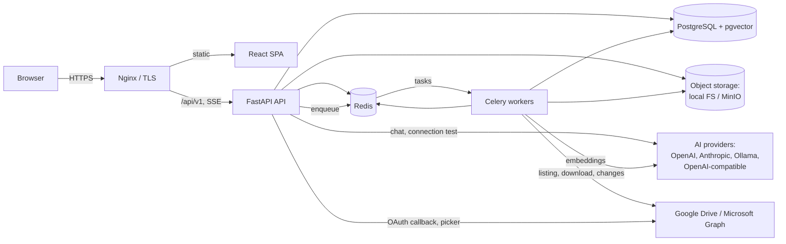
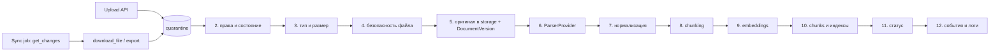
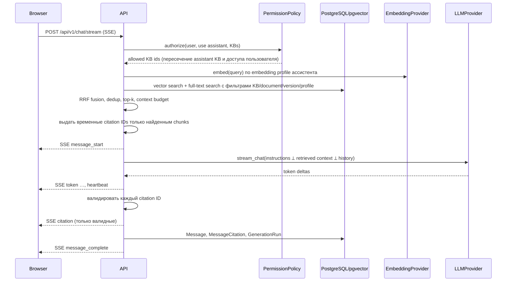

# PlummyKnowledge — Architecture

| | |
|---|---|
| Статус | Draft v0.1 (до начала реализации) |
| Источник | [PROJECT_BLUEPRINT.md](PROJECT_BLUEPRINT.md) v1.0 от 17.11.2026 |
| Решения | [ADR-001…009](adr/README.md) (Accepted) |
| Связанные документы | [PRODUCT_SPEC.md](PRODUCT_SPEC.md), [DATABASE_SCHEMA.md](DATABASE_SCHEMA.md), [API_CONTRACTS.md](API_CONTRACTS.md), [SECURITY_MODEL.md](SECURITY_MODEL.md), [DEVELOPMENT_ROADMAP.md](DEVELOPMENT_ROADMAP.md), [DEPLOYMENT.md](DEPLOYMENT.md), [../CLAUDE.md](../CLAUDE.md) |

**Как читать.** Ссылки вида `§N` указывают на раздел blueprint, из которого взято требование; такие пункты нормативны.
Пункты с пометкой **[Proposed]** blueprint не фиксирует — это рабочие решения, которые нужно подтвердить (а при
затрагивании framework, DB, queue, tenant model, auth/session strategy или публичного API — оформить ADR, §15).
При расхождении этого документа с Accepted ADR приоритет у ADR ([adr/README.md](adr/README.md)).

---

## 1. Архитектурные драйверы

| Драйвер | Следствие для архитектуры | § |
|---|---|---|
| Data ownership | Всё хранится в инсталляции владельца: PostgreSQL, object storage, Redis. Внешние вызовы — только к AI providers и источникам, которые настроил администратор. | §1 |
| Provider independence | LLM и embeddings — за отдельными интерфейсами `LLMProvider` / `EmbeddingProvider`; облачные и локальные модели равноправны. | §1, §5 |
| Source-grounded answers | Citation IDs генерирует и валидирует backend; ответ модели без валидных ссылок не принимается на веру. | §1, §6 |
| Least privilege | Авторизация выполняется в каждом use case, до retrieval и до передачи текста LLM. | §1, §8 |
| Deployability | Docker Compose quick start, healthchecks, readiness, миграции, setup wizard. | §1, §5 |
| Extensibility | Модели, хранилища, парсеры и коннекторы подключаются через стабильные интерфейсы (ports). | §1, §22 |

## 2. Архитектурный стиль

**Modular Monolith** (§3). Один кодовый репозиторий и один backend-артефакт, который запускается в двух ролях:
**API** (FastAPI) и **worker** (Celery). Обе роли используют одни и те же application use cases (§3).

Переход к микросервисам допустим только при доказанной потребности в одном из (§3):

- независимом масштабировании;
- отдельных security boundaries;
- отдельных командах.

Такой переход требует ADR.

## 3. Технологический стек (§3)

| Слой | Технологии |
|---|---|
| Backend | Python, FastAPI, SQLAlchemy 2.x (async), Pydantic v2, Alembic |
| Database | PostgreSQL + pgvector |
| Jobs / cache | Redis + Celery |
| Frontend | React 18, TypeScript, Vite, Chakra UI 2.8+, Redux Toolkit, RTK Query |
| API | REST; streaming — Server-Sent Events (SSE) |
| Parsing | Docling за интерфейсом `ParserProvider` |
| Storage | Local filesystem и S3-compatible abstraction (MinIO) |
| Deployment | Docker, Docker Compose, Nginx |
| Tests | Pytest, Vitest, React Testing Library, Playwright |
| Quality (Фаза 1) | Ruff, mypy/pyright; ESLint, Prettier, strict TypeScript; pre-commit; GitHub Actions |
| License | Apache License 2.0 |

Добавление любой новой зависимости требует обоснования (§15). Замена framework, DB или queue — только через ADR.

## 4. Логическая архитектура (§4)



Workers выполняют parsing, chunking, embeddings, source synchronization и cleanup (§4).

### 4.1 Runtime-компоненты

| Компонент | Ответственность | Масштабирование |
|---|---|---|
| `nginx` | TLS termination, раздача собранного SPA, reverse proxy на API, корректная проксировка SSE (без буферизации) | 1+ |
| `frontend` | Сборка React SPA (в production — статические файлы за Nginx) | — |
| `api` | HTTP/DTO, аутентификация, вызов use cases, SSE chat streaming. Никаких долгих операций (§11). | Горизонтально, ограниченный DB pool на процесс (§11) |
| `worker` | Celery tasks: стадии 8–12 ingestion (chunking, embeddings, переключение версии), purge, cleanup; позже sync. `plummy.workers`: фабрика приложения, JSON-only, `acks_late`, журнал жизненного цикла, `plummy.system.ping`. Очереди `default`, `embeddings`, `maintenance`; сеть `edge` для вызова embedding-провайдеров через `SafeHttpClient` | Регулируемое число workers и concurrency (§11) |
| `worker-ingestion` | Стадии 2–7 ingestion (проверки, тип, безопасность файла, storage, parsing через Docling): отдельный образ с Docling и моделями, очередь `ingestion`, concurrency 1, только сеть `data` (без интернета), без key ring и секретов провайдеров; parser — в дочернем процессе с timeout и rlimits, память ограничена `INGESTION_MEMORY_LIMIT` | Горизонтально, по одному документу на процесс |
| `scheduler` | Celery beat: периодические задачи `maintenance` — cleanup quarantine (1 ч), повторная публикация jobs, не дошедших до брокера (5 мин), sweep удалённых документов для purge (10 мин), sweep чата — зависшие `streaming`-ответы и удалённые диалоги (5 мин). Позже — расписания sync и reconciliation (§7). Только Redis, без storage и секретов | Ровно 1 экземпляр |
| `postgres` | Основное хранилище, pgvector, full-text search | Вертикально; backup/restore (§8, §11) |
| `redis` | Брокер Celery, кэш, rate limiting, распределённые locks | 1 |
| `minio` | S3-compatible storage (production-профиль, Фаза 11) | — |
| Локальные модели (Ollama, OpenAI-compatible) | Не часть платформы: сервисы владельца инсталляции; доступны API/worker только через network allowlist ([ADR-007](adr/0007-network-access-and-local-llm.md)) | — |

API и worker запускаются независимо (§11). Healthcheck и readiness есть у каждого сервиса (§5, §11).

**Очереди Celery:** `ingestion` (стадии 2–7, parsing — CPU/память), `embeddings` (стадии 8–12: chunking, I/O к
провайдеру, сохранение), `maintenance` (purge, cleanup, requeue, vector index), `default` (диагностика), `connectors` (синхронизация
внешних источников — [ADR-020](adr/0020-google-drive-connector.md)). Разделение позволяет ограничивать ресурсы parser-workers
отдельно (§8 п.6). Очереди обслуживают два сервиса: `worker-ingestion` (`ingestion`, без исходящего интернета) и
`worker` (`default`, `embeddings`, `maintenance`, `connectors`) — [DEPLOYMENT.md §2](DEPLOYMENT.md). Одноразовый сервис
`migrate` выполняет миграции и генерацию bootstrap token (ADR-006).

## 5. Слои и правило зависимостей (§3)

```text
            ┌──────────────┐      ┌──────────────┐
            │  api (HTTP)  │      │   workers    │   ← входные адаптеры
            └──────┬───────┘      └──────┬───────┘
                   │  вызывают одни и те же use cases
            ┌──────▼─────────────────────▼───────┐
            │         application (use cases)     │   ← зависит только от domain и ports
            └──────┬─────────────────────────────┘
                   │
            ┌──────▼───────┐        ┌──────────────────────┐
            │    domain    │◄───────│    infrastructure    │   ← реализует ports
            └──────────────┘        │ SQLAlchemy, SDK,      │
                                    │ Redis, storage, Docling│
                                    └──────────────────────┘
```

| Слой | Может импортировать | Не может импортировать |
|---|---|---|
| `domain` | stdlib, собственные типы | FastAPI, Celery, SQLAlchemy, SDK OpenAI/Anthropic, Google/Microsoft SDK (§3) |
| `application` | `domain`, интерфейсы (ports) | Конкретные адаптеры infrastructure, FastAPI, Celery, SDK |
| `infrastructure` | `domain`, `application` ports, SQLAlchemy, SDK, Redis, storage clients | `api`, `workers` |
| `api` | `application`, DTO-схемы, DI-composition | Бизнес-логику (никаких правил в routers, §3, §15) |
| `workers` | `application`, DI-composition | Бизнес-логику (никаких правил в tasks, §3) |

Правила:

- Бизнес-логика не дублируется в routers и Celery tasks (§3). Router: парсинг DTO → контекст безопасности →
  use case → DTO ответа. Task: десериализация payload → проверка состояния ресурса → use case.
- ORM entities не выходят за пределы infrastructure и никогда не отдаются из API (§10).
- **[Proposed]** Правило слоёв проверяется автоматически (например, `import-linter` в CI) — требует обоснования
  зависимости (§15).

## 6. Модули backend (§4)

| Модуль | Ответственность |
|---|---|
| `core` | Settings (Instance Settings, [ADR-006](adr/0006-initial-setup-and-system-configuration.md)), logging, exceptions, security primitives, `SafeHttpClient` ([ADR-007](adr/0007-network-access-and-local-llm.md)) |
| `setup` | Первоначальная настройка (`InitializeInstance`), bootstrap token, CLI администрирования ([ADR-006](adr/0006-initial-setup-and-system-configuration.md)) |
| `auth` | Login/logout, sessions, access/refresh tokens, CSRF, rate limiting login |
| `users`, `groups` | Identity и членство в группах ([ADR-012](adr/0012-single-organization-deployment.md): одна организация на инсталляцию, сущности организации нет) |
| `settings` | Application Settings ([ADR-006](adr/0006-initial-setup-and-system-configuration.md)) |
| `permissions` | Роли, permissions, policy service (проверка в каждом use case) |
| `providers` | Конфигурации AI providers, models, embedding profiles, connection test |
| `assistants` | Instructions, LLM, embedding/retrieval profile, KB, context limits; доступность ассистента ([ADR-005](adr/0005-assistant-access-model.md)) |
| `conversations` | Диалоги, сообщения, генерация, SSE, остановка генерации |
| `knowledge_bases` | KB, привязка источников, KB-level access, статусы индексации |
| `documents` | Documents, versions, удаление, source viewer |
| `data_sources` | Document Sources (`upload`, `google_drive`, `microsoft_365`), credentials, OAuth flow, picker ([ADR-008](adr/0008-unified-document-ingestion.md)) |
| `ingestion` | Единый pipeline из 12 стадий для всех источников ([ADR-008](adr/0008-unified-document-ingestion.md)), chunking |
| `retrieval` | Vector + FTS, hybrid fusion, фильтры, context assembly, citations |
| `synchronization` | Sync jobs, cursor/checkpoint, locks, reconciliation |
| `audit` | Запись и чтение audit log |
| `integrations/ai` | Адаптеры `LLMProvider`: OpenAI, Anthropic, Ollama, OpenAI-compatible |
| `integrations/embeddings` | Адаптеры `EmbeddingProvider` |
| `integrations/storage` | `StorageProvider`: local FS, S3/MinIO |
| `integrations/sources` | `DataSourceConnector`: Google Drive, Microsoft 365 |
| `workers` | Celery tasks и orchestration |

## 7. Структура репозитория (§4)

```text
plummy-knowledge/
├── apps/
│   ├── backend/
│   ├── frontend/
│   └── e2e/                      # Playwright (compose.e2e.yaml, фейковый провайдер — deploy/e2e)
├── packages/
│   ├── ai-providers/
│   ├── document-processing/
│   ├── retrieval/
│   └── connectors/
├── deploy/
│   ├── docker/
│   ├── compose/
│   └── nginx/
├── docs/
│   ├── architecture/
│   ├── development/
│   ├── deployment/
│   ├── integrations/
│   ├── security/
│   └── adr/
├── scripts/
├── .github/workflows/
├── CLAUDE.md
├── README.md
├── LICENSE
├── NOTICE
├── CONTRIBUTING.md
└── SECURITY.md
```

Рабочие спецификации верхнего уровня лежат в `docs/` (§15): `PROJECT_BLUEPRINT.md`, `ARCHITECTURE.md`,
`DATABASE_SCHEMA.md`, `API_CONTRACTS.md`, `SECURITY_MODEL.md`; планируются `PRODUCT_SPEC.md`,
`DEVELOPMENT_ROADMAP.md`. Подкаталоги `docs/{architecture,…}` — для детальных материалов.

**[Proposed] Внутренняя структура `apps/backend`:**

```text
apps/backend/
├── pyproject.toml
├── alembic/                      # миграции
├── src/plummy/
│   ├── core/                     # settings, logging, exceptions, security primitives
│   ├── domain/<module>/          # entities, value objects, domain rules, errors
│   ├── application/<module>/     # use cases, ports (Protocol), policy checks
│   ├── infrastructure/
│   │   ├── db/                   # SQLAlchemy models, repositories, unit of work
│   │   ├── integrations/{ai,embeddings,storage,sources}/
│   │   ├── parsing/              # Docling adapter
│   │   └── crypto/               # шифрование секретов
│   ├── api/v1/<module>/          # routers, DTO
│   ├── workers/                  # Celery app, tasks
│   └── composition.py            # DI wiring для api и workers
└── tests/{unit,integration,contract,security,e2e}/
```

**Реализовано в Фазе 1** (каталоги создаются по мере появления кода, пустые модули не заводятся):

```text
apps/backend/
├── pyproject.toml, uv.lock       # зависимости (uv), Ruff, mypy strict, pytest
├── alembic.ini, alembic/         # 0001: проверка расширений vector, citext (ADR-011)
├── src/plummy/
│   ├── main.py                   # create_app() factory + lifespan (uvicorn --factory)
│   ├── composition.py            # Resources: engine, session factory, Redis, CheckReadiness
│   ├── core/                     # config.py (Settings), logging.py (JSON), version.py (VERSION)
│   ├── application/health/       # CheckReadiness + port DependencyCheck
│   ├── infrastructure/db/        # engine, Base (naming convention), проверки БД/миграций
│   ├── infrastructure/redis/     # клиент, проверка Redis
│   └── api/                      # router (/api), v1/health, errors (problem+json), middleware (X-Request-ID)
└── tests/{unit,api,integration}/

apps/frontend/src/
├── main.tsx
├── app/                          # providers (Redux, Chakra), store, routes, theme
├── shared/                       # api (baseApi RTK Query, нормализация ошибок), config (env), components
├── features/health/              # healthApi (readiness), SystemStatusCard
├── features/chat/                # /chat: SSE-клиент (sse.ts, chatStream.ts), useChatTurn, Markdown ответа
├── features/viewer/              # /viewer: защищённый просмотр цитируемого фрагмента
├── layouts/, pages/              # AppLayout; Home, NotFound, RouteError
└── test/                         # setup и утилиты Vitest
```

Сессия/транзакции: одна `AsyncSession` на запрос (`get_db_session`); границы транзакций явно задаются в use cases
(`async with session.begin()`), незакоммиченное откатывается при закрытии сессии. `workers/` — входной адаптер
Celery: `app.py` (конфигурация), `main.py` (entrypoint `celery -A plummy.workers.main worker`), `observability.py`
(события `task.started/finished/retry/failed` без аргументов, результатов и текстов исключений), `tasks/`.
Задачи вызывают use cases и не содержат бизнес-правил; повторная доставка после сбоя (`acks_late`) требует
идемпотентности каждой задачи.

Пакеты `packages/*` используются для переиспользуемых, независимых от приложения библиотек (адаптеры провайдеров,
обработка документов, retrieval, коннекторы). **Открытый вопрос:** какие из них выделять в отдельные Python-пакеты
в MVP, а какие держать внутри `apps/backend` до появления второго потребителя.

## 8. Ключевые интерфейсы (ports)

Сигнатуры ниже — **черновик контрактов** для Фаз 4–5 и 9–10. Их назначение и обязательные свойства нормативны
(§5, §6, §7, §13); конкретные имена параметров и типов уточняются при реализации.

### 8.1 `LLMProvider` (§5, §13 Фаза 4)

```python
class LLMProvider(Protocol):
    def capabilities(self) -> LLMCapabilities: ...          # streaming, max context, tool support (в MVP tools не используются, §8)
    async def test_connection(self, *, timeout: float) -> ConnectionTestResult: ...
    def stream_chat(
        self,
        request: ChatRequest,            # model_id, system/instructions, messages, retrieved context — раздельно (§8)
        *,
        cancel: CancellationToken,       # остановка генерации (§5)
        timeout: float,
    ) -> AsyncIterator[ChatStreamEvent]: ...                # text delta, usage, finish reason
```

Облачные и локальные модели (Ollama, локальные OpenAI-compatible API) используют **один и тот же** интерфейс; различие
только в сетевой политике — все HTTP-вызовы адаптеров идут через `SafeHttpClient` ([ADR-007](adr/0007-network-access-and-local-llm.md)).

Ошибки — типизированные (`ProviderAuthError`, `ProviderEgressDenied`, `ProviderRateLimited`, `ProviderTimeout`, `ProviderUnavailable`,
`ProviderBadRequest`, `ProviderContentFiltered` — **[Proposed]** по составу). Retry/backoff и timeout —
на уровне адаптера/обёртки (§13 Фаза 4). Адаптеры: OpenAI, Anthropic, Ollama, OpenAI-compatible (§5).

### 8.2 `EmbeddingProvider` (§5)

```python
class EmbeddingProvider(Protocol):
    def capabilities(self) -> EmbeddingCapabilities: ...    # dimensions, max batch, max input tokens
    async def test_connection(self, *, timeout: float) -> ConnectionTestResult: ...
    async def embed(self, texts: Sequence[str], *, model_id: str, cancel: CancellationToken) -> list[Vector]: ...
```

Отдельный интерфейс от `LLMProvider` (§5). Каждый вектор связан с embedding profile (§9); смена модели/профиля
требует переиндексации (§5).

### 8.3 `ParserProvider` (§3, §6)

```python
class ParserProvider(Protocol):
    @property
    def name(self) -> str: ...                                   # сохраняется в версии документа
    def supported_formats(self) -> frozenset[DocumentFormat]: ...
    async def parse(self, path: Path, file_format: DocumentFormat, limits: ParseLimits) -> NormalizedDocument: ...
```

Parser получает локальный read-only путь (`StorageProvider.local_path`) и формат, уже определённый по содержимому
на стадии 3; `ParserRegistry` выбирает реализацию по формату.

`NormalizedDocument` — независимая от парсера структура: страницы, секции/заголовки, параграфы, таблицы, листы и
строки (для XLSX/CSV), metadata. Первая реализация — Docling (§3). Лимиты страниц, времени и ресурсов передаются
явно (§8 п.6).

### 8.4 `ChunkingStrategy` (§6, §13 Фаза 5)

```python
class ChunkingStrategy(Protocol):
    @property
    def name(self) -> str: ...                                   # сохраняется в chunk set
    def chunk(self, document: NormalizedDocument, settings: ChunkingSettings) -> list[ChunkDraft]: ...
```

`ChunkingSettings` по умолчанию: `max_tokens = 512`, `overlap_tokens = 64` (overlap — только между частями одного
слишком длинного блока); размер ограничивается `max_input_tokens` embedding profile. Настройки на уровне KB
(`knowledge_bases.chunking_settings`) — **[Proposed]**: API для них пока нет, всегда используются значения по
умолчанию.

Structure-aware: каждый chunk сохраняет page / section / sheet / row (§6). Детерминированность обязательна для
идемпотентности (одинаковый вход → одинаковые `chunk_index` и `content_hash`).

### 8.5 `StorageProvider` (§3, §13 Фаза 5)

```python
class StorageProvider(Protocol):
    async def put(self, area: StorageArea, key: StorageKey, data: AsyncIterable[bytes], *,
                  max_bytes: int | None = None) -> StoredObject: ...       # никогда не перезаписывает
    def open(self, area: StorageArea, key: StorageKey) -> AsyncIterator[bytes]: ...
    def local_path(self, area: StorageArea, key: StorageKey) -> AbstractAsyncContextManager[Path]: ...
    async def move(self, key: StorageKey, source: StorageArea, target: StorageArea) -> None: ...
    async def delete(self, area: StorageArea, key: StorageKey) -> None: ...  # отсутствующий объект — не ошибка
    async def exists(self, area: StorageArea, key: StorageKey) -> bool: ...
    async def purge_expired(self, area: StorageArea, older_than: datetime) -> int: ...
```

`StorageArea`: `quarantine` (временная, ограниченные права, cleanup, §8 п.8) и `documents`. Ключи генерирует
сервер (UUID-based); имя файла пользователя **никогда** не используется как путь (§12: malicious filenames не
выходят из storage). Реализации: local filesystem (`STORAGE_BACKEND=local`, реализована), S3-compatible (MinIO) — Фаза 11.

### 8.6 `DataSourceConnector` (§7)

```python
class DataSourceConnector(Protocol):
    def capabilities(self) -> ConnectorCapabilities: ...    # incremental changes, export formats, picker, revoke
    async def validate_connection(self, ctx: ConnectorContext) -> ValidationResult: ...
    def list_files(self, ctx: ConnectorContext, scope: SourceScope, *, page_token: str | None) -> AsyncIterator[RemoteFilePage]: ...
    async def download_file(self, ctx: ConnectorContext, file: RemoteFileRef, *, cancel: CancellationToken) -> AsyncIterator[bytes]: ...
    async def get_changes(self, ctx: ConnectorContext, cursor: SyncCursor | None) -> ChangesPage: ...  # + новый cursor
    async def get_metadata(self, ctx: ConnectorContext, file: RemoteFileRef) -> RemoteFileMetadata: ...  # ETag/version
```

Реальный контракт включает (§7): pagination, cancellation, retries, rate limits, typed errors, ETag/version,
capabilities. Для источника типа `upload` коннектор не нужен: стадия «получение документа» берёт поток из HTTP-запроса,
дальше pipeline общий ([ADR-008](adr/0008-unified-document-ingestion.md)). Typed errors ([ADR-020](adr/0020-google-drive-connector.md) §9): `ConnectorAuthRevoked`, `ConnectorRateLimited`,
`ConnectorQuotaExceeded`, `ConnectorNotFound`, `ConnectorPermissionDenied`, `ConnectorTransientError`,
`ConnectorCursorInvalid` (требует full resync).

### 8.7 Прочие ports

| Port | Назначение |
|---|---|
| `SecretCipher` | Шифрование/дешифрование секретов; ключ вне БД (§5, §8). См. [SECURITY_MODEL.md](SECURITY_MODEL.md). |
| `PermissionPolicy` | Policy service: `authorize(actor, action, resource)`; вызывается в каждом use case (§5, §13 Фаза 3). Пока ресурсов нет, use cases проверяют права через `SecurityContext.require(permission)`; policy service вводится с первым ресурсом с доступом по объекту (KB). |
| `AuditSink` | Запись audit events (§8 п.9). |
| `JobDispatcher` | Постановка Celery tasks из application без импорта Celery в application (§3). |
| `Clock`, `IdGenerator` | Детерминируемость в тестах. `Clock` реализован (`application/ports.py`); id — UUIDv7 `core/ids.new_id`. |
| `SafeHttpClient` | Единственный путь исходящих HTTP-соединений: allowlist, проверка фактического IP, pinning, повторная проверка redirects (§8 п.7, [ADR-007](adr/0007-network-access-and-local-llm.md)). |
| `SettingsProvider` | Чтение Instance Settings (только чтение) и effective Application Settings ([ADR-006](adr/0006-initial-setup-and-system-configuration.md)). |

## 9. Сквозные потоки

### 9.1 Контекст безопасности (§5, §8, [ADR-012](adr/0012-single-organization-deployment.md), [ADR-013](adr/0013-auth-session-strategy.md))

- **API** (реализовано): зависимость `CurrentContext` (`api/security.py`) читает cookie сессии, use case
  `AuthenticateSession` проверяет сессию в PostgreSQL (не отозвана, не истекла по простою и абсолютному сроку,
  пользователь активен, сессия не старше смены пароля) и строит `SecurityContext{user_id, session_id, email,
  display_name, roles, permissions}`. Пользователь и права **никогда** не берутся из тела запроса, query или
  заголовков клиента (§5). Нет сессии → `401`; `require_permission("…")` даёт ранний `403`, но не заменяет проверку
  прав в use case (`SecurityContext.require`, далее `PermissionPolicy`).
- **Repositories** доступа к данным KB принимают вычисленный policy service набор разрешённых KB/источников; запрос
  без фильтра доступа — ошибка программиста, ловится тестами «KB без доступа недоступна».
- **Jobs:** payload задачи содержит id ресурса и `correlation_id`. Worker заново загружает ресурс и проверяет, что он
  не удалён и источник активен (§8 п.1). Права пользователя-инициатора проверяются при постановке задачи; worker
  выполняет только системные действия над ресурсом.
- Организации в контексте нет: инсталляция принадлежит одной организации (ADR-012).

### 9.2 Ingestion pipeline (§6, [ADR-008](adr/0008-unified-document-ingestion.md))

Один pipeline для локальных файлов и внешних коннекторов (§22 п.3). Источник документа — **Document Source**
(`DataSource`): `upload`, `google_drive`, `microsoft_365`.



| # | Стадия (ADR-008) | Шаг blueprint §6 | Где | Идемпотентность / примечание |
|---|---|---|---|---|
| 1 | Получение документа из источника | 1, 2 | API (upload) / worker (коннектор) | Upload: `Idempotency-Key` — [Proposed], не реализован: каждый upload создаёт новый документ; коннектор: `(data_source_id, external_id)` + ETag |
| 2 | Проверка разрешений и состояния ресурсов | — (§8 п.1–2) | worker | Источник активен и не удалён; KB/документ не удалены; файл в выбранной области |
| 3 | Проверка типа и размера | 3 | worker | Тип по содержимому |
| 4 | Проверка безопасности файла | 3 | worker | Лимиты страниц, распаковки, macro-форматы |
| 5 | Сохранение оригинала в storage | 2, 5 | worker | Unique `(document_id, checksum_sha256)` — тот же контент не создаёт новую версию |
| 6 | Извлечение текста через `ParserProvider` | 4 | worker (очередь `ingestion`) | Timeout и лимиты ресурсов |
| 7 | Нормализация содержимого и metadata | 4, 5 | worker | `NormalizedDocument` |
| 8 | Chunking | 6 | worker | Unique `(document_version_id, chunk_set, chunk_index)` |
| 9 | Embeddings | 7 | worker (очередь `embeddings`) | Unique `(chunk_id, embedding_config_id)` |
| 10 | Сохранение chunks и индексов | 8 | worker, транзакционно | Активация `chunk_set`; повтор не дублирует строки (§12) |
| 11 | Обновление статуса обработки | 9 | worker | Версия `ready`, переключение `current_version_id`, предыдущая → `outdated` |
| 12 | События и логирование | 9 | worker | Статусы `IngestionJob`, лог с `job_id`/`correlation_id`, метрики (§11) |

Правила: все долгие операции — в Celery (§6, §11); повторный запуск идемпотентен — job для уже обработанной версии
завершается без изменений (SC-09); временные ошибки — retry с backoff, постоянные — `failed` без повторов, после
исчерпания попыток — `dead` с диагностикой (без содержимого документа в логах, §11). Форматы MVP: PDF, DOCX, XLSX,
TXT, CSV, Markdown (§6); релиз 0.1.0 обязан поддерживать PDF/DOCX (§19), XLSX/CSV — 0.2.0.

Новая версия становится доступной retrieval атомарно: `documents.current_version_id` переключается только после
успешной стадии 10. Бизнес-логика pipeline не зависит от Google/Microsoft SDK — они используются только внутри
адаптеров `DataSourceConnector`.

### 9.3 Удаление и reindex (§5, §8, [ADR-008](adr/0008-unified-document-ingestion.md))

- **Удаление документа:** в одной транзакции документ помечается удалённым (`deleted_at`, `deletion_reason`) →
  немедленно исключается из retrieval (§5, §8 Retention), его активные jobs отменяются. Сразу после commit
  публикуется `maintenance`-задача purge, которая удаляет chunks, embeddings и файлы версий из storage; если брокер
  недоступен, документ подхватывает периодический sweep `scheduler`. Повтор purge безопасен. Отсрочка purge
  (grace period) не реализована — см. [DATABASE_SCHEMA.md §8](DATABASE_SCHEMA.md).
- **Удаление в источнике / выход за выбранную область:** тот же lifecycle, `deletion_reason = remote_deleted |
  out_of_scope`.
- **Удаление источника:** все его документы проходят тот же lifecycle; credentials удаляются сразу.
- **Смена chunking settings:** строится новый `chunk_set` версии; retrieval переключается на него атомарно
  (`active_chunk_set`), старый набор удаляется.
- **Смена embedding profile:** создаётся новый profile; reindex-jobs пишут embeddings для нового profile рядом со
  старыми; после завершения KB/Assistant переключаются на новый profile; старые vectors удаляются по retention (§5).

### 9.4 Retrieval и генерация ответа (§6)

Один retrieval pipeline для всех источников (§22 п.4).



Обязательные свойства:

0. Доступность ассистента проверяется на **каждом** сообщении: пользователь должен иметь доступ ко всем KB
   ассистента ([ADR-005](adr/0005-assistant-access-model.md)). Chat API не принимает идентификаторы KB или источников от
   клиента — список разрешённых источников backend вычисляет сам.
1. Авторизация до retrieval и до передачи текста LLM (§8 п.2). Фильтрация по KB, источникам, документам и версиям —
   **в SQL-запросе**, а не пост-фильтрацией результата (§6).
2. В retrieval участвуют только `ready`-версии, являющиеся текущими; deleted/failed/outdated исключены (§9).
3. Hybrid fusion — Reciprocal Rank Fusion (§6); параметры (k RRF, top-k для каждой ветки, итоговый top-k, context
   budget в токенах) — часть retrieval profile ассистента. Reranker — следующая фаза (§6).
4. Context assembly ограничен (bounded) бюджетом ассистента (§13 Фаза 6).
5. Инструкции и retrieved context разделены; retrieved context помечен как недоверенный (§8).
6. Модель может сослаться только на выданные citation IDs; любой иной ID отклоняется (§6, §12).
7. Если источники не содержат ответа — корректный отказ (§6).
8. Генерацию можно остановить (§5): отмена закрывает поток провайдера через `CancellationToken`, сообщение
   сохраняется со статусом `stopped`.

**Реализовано в фазе 6** (без генерации — она в фазе 8):

- `application/retrieval`: `RetrieveChunks` — нормализация запроса (NFC, 1–1000 символов), авторизация каждой KB
  (`read`) и вычисление источников **до** embedding; KB с разными embedding profiles вместе не ищутся
  (`mixed_embedding_profiles`). Ветки: vector (`infrastructure/db/retrieval.py`, выражение и предикат partial
  HNSW-индекса [ADR-017](adr/0017-vector-storage.md); точный перебор при < 10 000 кандидатов, иначе iterative
  scan) и FTS (совпадение по любому слову: `plainto_tsquery` с `&` → `|`, ранжирование `ts_rank`,
  [ADR-018](adr/0018-full-text-search-configuration.md) §3; запрос из одних стоп-слов пропускает FTS). Далее взвешенный RRF (`k = 60`, вес vector 1,0, keyword 0,1 — по
  baseline [docs/evaluation/](evaluation/baseline-2026-11.md)), dedup по `content_hash`, top-k и бюджет
  токенов (по умолчанию 8 chunks, 40 кандидатов на ветку, 8000 токенов). Текст запроса не логируется.
- `application/retrieval/context.py`: `CitationRegistry` (`c1…cn` только для отобранных chunks),
  `build_chat_request` (system rules первыми, chunks — только в `ChatRequest.context`, который адаптеры
  экранируют в блоке `<documents>`), `CitationFilter` для потока ответа (API_CONTRACTS §3.4).
- `POST /api/v1/knowledge-bases/{id}/search` — retrieval без генерации для пользователей с `read`.
- Оценка качества — [docs/evaluation/](evaluation/README.md) (`python -m plummy.cli eval run`).

**Генерация выполняется в процессе API** ([ADR-019](adr/0019-answer-generation-in-api-process.md)): стриминг токенов —
I/O-bound, не «долгая операция» в смысле §11. Жёсткий timeout, не более 2 одновременных генераций на пользователя
(семафор в Redis), остановка через флаг в Redis (работает при нескольких процессах API), обрыв соединения отменяет
генерацию, `Last-Event-ID` в MVP нет.

### 9.5 Синхронизация источников (§7)

- Job per source; `sync_cursor` (Google Changes API page token / Microsoft Graph delta link) хранится в БД и
  обновляется только после успешной обработки страницы изменений (checkpoint).
- Lock от параллельного sync: partial unique index в БД + короткий Redis lock (см. DATABASE_SCHEMA.md).
- Backoff с jitter при throttling/quota (`Retry-After` уважается), retry, dead-letter/error state.
- Запуск вручную и по расписанию; периодический reconciliation (полный listing и сравнение с индексом) для
  выявления пропущенных изменений.
- Rename/move → обновление metadata без переиндексации, если контент не изменился; delete/выход из выбранной
  папки → удаление документа по общему lifecycle; изменение контента → новая `DocumentVersion`.
- Revoke/disconnect: credentials помечаются отозванными, sync останавливается, документы источника — по решению
  администратора (см. SECURITY_MODEL.md).
- Каждое изменение из источника входит в стадию 1 общего ingestion pipeline ([ADR-008](adr/0008-unified-document-ingestion.md)).
- Сетевые вызовы коннекторов — через `SafeHttpClient`; redirects загрузки проверяются заново ([ADR-007](adr/0007-network-access-and-local-llm.md)).
- Важно: выбранная в UI папка — это **application-level filtering**, а не OAuth-level isolation (§7).
- Google Drive: начальная синхронизация, Changes API, правила области папки, форматы экспорта, расписание и
  backoff — [ADR-020](adr/0020-google-drive-connector.md) §8.

## 10. Конфигурация, первоначальная настройка и сеть (§5, [ADR-006](adr/0006-initial-setup-and-system-configuration.md), [ADR-007](adr/0007-network-access-and-local-llm.md))

### 10.1 Два уровня настроек

| | Instance Settings | Application Settings |
|---|---|---|
| Кто управляет | Владелец инсталляции (доступ к серверу) | Administrator (`settings.manage`) |
| Где | env, `*_FILE`-секреты, конфигурационный файл; Pydantic Settings | Строка-синглтон (типизированная модель, версия схемы); появится в фазе Application Settings |
| API | Только чтение для Administrator (`GET /api/v1/system/settings`) | `GET/PATCH /api/v1/settings` |
| Применение | При старте процессов | Сразу |

Application Settings могут только сужать instance policy; effective value — более строгое из двух значений.
Сеть, storage, ключи и системные лимиты задаются только на уровне инсталляции.

- `.env.example` без секретов (§5); безопасные defaults: secure cookies включены, debug выключен, CORS закрыт,
  SSRF-защита включена, allowlist пуст, лимиты upload выставлены.
- Ключ шифрования секретов — только вне БД (env/файл/secret mount) (§5, §8).
- Ошибка конфигурации при старте → понятная диагностика и ненулевой exit code (§5).

### 10.2 Первоначальная настройка

```mermaid
sequenceDiagram
    participant Op as Владелец (сервер)
    participant CLI as plummy CLI
    participant DB as PostgreSQL
    participant W as Setup wizard
    participant A as API /setup
    Op->>CLI: миграции + setup init-token
    CLI->>DB: instance_state: hash(token), expires_at
    CLI-->>Op: токен в файле 0600 (в логах только путь)
    Op->>W: вводит токен, email, имя, пароль администратора
    W->>A: POST /api/v1/setup/initialize
    A->>DB: BEGIN; SELECT instance_state FOR UPDATE
    A->>A: не инициализировано? токен валиден? Origin?
    A->>DB: пользователь, роль admin, initialized_at, токен погашен, audit, сессия
    A-->>W: 201 + сессия
```

Режим `cli_only` отключает web-initialize; восстановление администратора — только CLI на сервере.

### 10.3 Исходящие соединения

Все исходящие HTTP-соединения (AI-провайдеры, connection tests, коннекторы, OAuth) идут через `SafeHttpClient`:
запрет внутренних и опасных адресов по умолчанию, явный allowlist в Instance Settings с назначением и CIDR, проверка
фактического IP, pinning, повторная проверка redirects. Локальные модели подключаются через тот же `LLMProvider` /
`EmbeddingProvider` после добавления записи allowlist владельцем инсталляции.

## 11. Observability (§11)

| Что | Как |
|---|---|
| Logs | Структурированные (JSON), уровень настраивается; поля `correlation_id`, `job_id`, `user_id` (где применимо) |
| Correlation | `X-Request-ID` принимается/генерируется на входе, прокидывается в jobs и в audit log |
| Health | `GET /api/v1/health/live` (процесс жив), `GET /api/v1/health/ready` (БД, Redis, storage, миграции применены) |
| Метрики | API latency, retrieval latency, time-to-first-token, ingestion throughput, queue depth, worker memory, DB latency (§11) |
| Запрещено в обычных логах | Содержимое документов, токены, пароли, API keys, приватные prompts (§11) |

**[Proposed]** Формат экспорта метрик — Prometheus-совместимый endpoint; выбор и инструмент — отдельный ADR.

## 12. Deployment (§3, §13 Фазы 1, 11)

- **Development:** Docker Compose — PostgreSQL+pgvector, Redis, backend, worker, frontend; healthchecks (§13 Фаза 1).
- **Production:** Compose profiles, Nginx TLS, production secrets и resource limits, S3-compatible storage/MinIO,
  backup/restore, upgrades, retention, worker scaling, admin jobs/sync dashboard и troubleshooting (§13 Фаза 11).
- Миграции Alembic выполняются отдельным шагом/командой до запуска новой версии API; readiness не проходит, пока
  миграции не применены. **[Proposed]**
- Обновления — по SemVer (§13 Фаза 13); миграции проверяются на чистой БД и upgrade path (§20).
- Подробности окружения, секретов, volumes, bootstrap и сетевой конфигурации — [DEPLOYMENT.md](DEPLOYMENT.md).

## 13. Frontend (§3, §10)

- React 18 + TypeScript (strict) + Vite; Chakra UI 2.8+; Redux Toolkit; RTK Query для REST; router (§21 п.3).
- Разделы (§10): Login/Setup, Dashboard, Chat, Assistants, Knowledge Bases, Documents, Data Sources,
  Providers & Models, Users & Groups, Roles & Permissions, Jobs/Sync, Audit, System Settings.
- Setup wizard работает только при `GET /setup/status = uninitialized`, но решение о допуске принимает backend
  (ADR-006). System Settings: настройки приложения (редактирование) и настройки инсталляции (только чтение для
  Administrator).
- SSE-клиент с типизированными событиями и остановкой генерации (§13 Фаза 8, реализовано). Поскольку отправка
  сообщения — `POST` с CSRF-заголовком, используется `fetch` + чтение `ReadableStream` (нативный `EventSource`
  поддерживает только `GET`): инкрементальный парсер `text/event-stream` (`features/chat/sse.ts`), события
  `message_start`/`token`/`citation`/`message_complete`/`error`, heartbeat-комментарии пропускаются. Уход со
  страницы или из диалога прерывает запрос (`AbortController`) — backend останавливает генерацию и сохраняет
  частичный ответ ([ADR-019](adr/0019-answer-generation-in-api-process.md)); кнопка Stop — `POST /chat/runs/{id}/stop`.
  Новый диалог получает адрес `/chat/{id}` по `message_start` без перемонтирования страницы (один маршрут
  `chat/:conversationId?`). Session ID и CSRF-токен не попадают в `localStorage`.
- Ответ модели — Markdown (`react-markdown` + `remark-gfm`): сырой HTML отбрасывается (`skipHtml`), изображения не
  загружаются (вместо них ссылка), ссылки — только http(s), `target="_blank"`, `rel="noopener noreferrer nofollow"` и
  домен рядом; маркеры `[cN]` становятся ссылками на viewer только для цитат, выданных backend.
- Citation display и защищённый in-app viewer — открываются через internal viewer route
  `/viewer/documents/{id}/versions/{vid}?chunk={cid}`, а не внешнюю ссылку Drive/SharePoint (§5); маршрут строится
  из проверенных UUID, текст документа показывается только как текст, backend проверяет доступ на каждом открытии.
- Loading/error/empty states и accessibility обязательны (§13 Фаза 8).
- Frontend **не является security boundary** (§5): скрытие кнопок — UX, не защита.
- **[Proposed]** Типы DTO генерируются из OpenAPI-схемы FastAPI, чтобы контракт не расходился.

## 14. Тестовая архитектура (§12)

| Уровень | Покрытие |
|---|---|
| Unit | Permissions, chunking, citation validation, domain rules |
| Integration | PostgreSQL/pgvector, Redis, storage, provider adapters |
| Contract | AI providers и connectors (общий набор тестов на каждый адаптер) |
| E2E | Основные пользовательские сценарии (Playwright, `apps/e2e`): отдельный Compose-проект `compose.e2e.yaml` без опубликованных портов, фейковый OpenAI-compatible провайдер в allowlist тестового `CONFIG_FILE`; login → вопрос → ответ с цитатой → viewer, stop, SC-01 из браузера |
| Security | Изоляция KB и пользователей, RBAC, sessions/CSRF, SSRF, uploads, prompt injection |
| Performance | Retrieval, ingestion, concurrent chat |
| Recovery | Backup restore, worker restart, interrupted sync |

RAG evaluation (§6): 30–50 документов, 50–100 вопросов (включая вопросы без ответа, похожие документы,
конфликтующие версии); метрики Recall@K, MRR/nDCG, citation precision/coverage, groundedness.

## 15. Безопасность (обзор)

Полная модель — [SECURITY_MODEL.md](SECURITY_MODEL.md). Архитектурно безопасность обеспечивается так:

| Механизм | Где в архитектуре | Решение |
|---|---|---|
| Модель развёртывания | Одна организация на инсталляцию; изоляция организаций — отдельными инсталляциями | [ADR-012](adr/0012-single-organization-deployment.md) |
| Аутентификация | Серверные сессии (хэш токена в БД), HttpOnly cookie, CSRF-токен из сессии + `Origin`, Argon2id, лимиты входа | [ADR-013](adr/0013-auth-session-strategy.md) |
| RBAC и KB-level доступ | `SecurityContext` из сессии, `PermissionPolicy` в каждом use case, фильтры доступа к KB в SQL | [ADR-012](adr/0012-single-organization-deployment.md) |
| Доступ к ассистентам | `PermissionPolicy.can_use_assistant` на каждом запросе | [ADR-005](adr/0005-assistant-access-model.md) |
| Защита RAG | Фильтры в SQL до LLM, повторная проверка chunks, валидация citation IDs, разделение инструкций и контекста | §9.4 |
| Bootstrap | Одноразовый токен, атомарная инициализация | [ADR-006](adr/0006-initial-setup-and-system-configuration.md) |
| Сеть | `SafeHttpClient`, allowlist уровня инсталляции | [ADR-007](adr/0007-network-access-and-local-llm.md) |
| Недоверенные файлы | Quarantine, стадии 2–4 pipeline для всех источников, изолированный парсер | [ADR-008](adr/0008-unified-document-ingestion.md) |
| Секреты | `SecretCipher`, ключ вне БД, write-only API | SECURITY_MODEL.md §7 |

## 16. Принципы расширения

- **Новый LLM/embedding-провайдер** — адаптер `LLMProvider`/`EmbeddingProvider` + contract tests; сетевой доступ — через
  `SafeHttpClient`. Изменения в application не нужны.
- **Новый тип источника** — реализация `DataSourceConnector`, значение `data_sources.type`, contract tests; ingestion
  pipeline не меняется (ADR-008).
- **Новый парсер или формат** — реализация `ParserProvider` / расширение `NormalizedDocument`; лимиты безопасности
  обязательны.
- **Новое хранилище** — реализация `StorageProvider`.
- **Новые права** — новый ключ permission в каталоге (миграция данных) и проверка в use case; изменение модели доступа
  — через ADR (например, расширение ADR-005).
- **Не расширяется без ADR:** framework, DB, queue, tenant model, auth/session strategy, публичный API (§15); выдача
  модели инструментов (tools) (§8, §14).
- Новые абстракции создаются только при реальной второй реализации или явной потребности в изоляции SDK.

## 17. Архитектурные решения и ADR (§1, §15)

ADR обязателен **до** изменения: framework, DB, queue, tenant model, auth/session strategy, публичного API (§15).
ADR хранятся в [`docs/adr/`](adr/README.md) с индексом (§13 Фаза 0).

| ADR | Тема | Статус |
|---|---|---|
| [ADR-001](adr/0001-record-architecture-decisions.md) | Record architecture decisions | Accepted |
| [ADR-002](adr/0002-modular-monolith-and-layering.md) | Modular Monolith и правило зависимостей слоёв | Accepted |
| [ADR-003](adr/0003-technology-stack.md) | Базовый технологический стек | Accepted |
| [ADR-004](adr/0004-tenant-isolation-and-kb-level-access.md) | Tenant isolation и доступ на уровне KB | Superseded by ADR-012 |
| [ADR-005](adr/0005-assistant-access-model.md) | Assistant Access Model | Accepted |
| [ADR-006](adr/0006-initial-setup-and-system-configuration.md) | Initial Setup and System Configuration | Accepted |
| [ADR-007](adr/0007-network-access-and-local-llm.md) | Network Access and Local LLM Providers | Accepted |
| [ADR-008](adr/0008-unified-document-ingestion.md) | Unified Document Ingestion | Accepted |
| [ADR-009](adr/0009-automatic-versioning.md) | Automatic Versioning | Accepted |
| [ADR-010](adr/0010-api-error-format.md) | API Error Format (RFC 9457) | Accepted |
| [ADR-011](adr/0011-database-roles-and-extensions.md) | PostgreSQL Roles and Extensions | Accepted |
| [ADR-012](adr/0012-single-organization-deployment.md) | Single-Organization Deployment | Accepted |
| [ADR-013](adr/0013-auth-session-strategy.md) | Auth and Session Strategy | Accepted |
| [ADR-014](adr/0014-list-pagination.md) | List Pagination | Accepted |
| [ADR-015](adr/0015-user-activation-links.md) | User Onboarding by Activation Link | Accepted |
| [ADR-016](adr/0016-secret-encryption.md) | Secret Encryption at Rest | Accepted |
| [ADR-017](adr/0017-vector-storage.md) | Vector Storage in pgvector | Accepted |
| [ADR-018](adr/0018-full-text-search-configuration.md) | Full-Text Search Configuration | Accepted |
| [ADR-019](adr/0019-answer-generation-in-api-process.md) | Answer Generation in the API Process | Accepted |

Темы будущих ADR (хранилище idempotency keys, роли БД, RLS) перечислены в [adr/README.md](adr/README.md).

## 18. Открытые вопросы

1. Выделение `packages/*` в отдельные пакеты в MVP или после появления второго потребителя.
2. Ограничение одновременных генераций и поведение при разрыве SSE-соединения (продолжать генерацию и сохранять
   ответ или отменять).
3. Инструмент проверки правила слоёв в CI.
