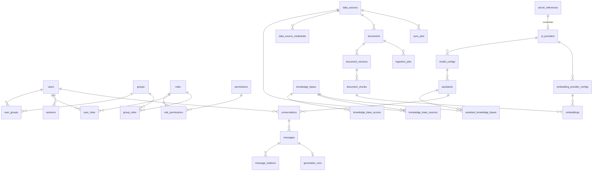

# PlummyKnowledge — Database Schema

| | |
|---|---|
| Статус | v0.3 — identity-таблицы (Фазы 2–3), `secret_references` и AI-таблицы (Фаза 4) реализованы; остальное — рабочий проект |
| Источник | [PROJECT_BLUEPRINT.md](PROJECT_BLUEPRINT.md) §5, §6, §7, §8, §9, §12, §20 |
| СУБД | PostgreSQL + pgvector (§3) |
| Миграции | Alembic (§3) |
| Решения | [ADR-012](adr/0012-single-organization-deployment.md), [ADR-013](adr/0013-auth-session-strategy.md), [ADR-005](adr/0005-assistant-access-model.md), [ADR-006](adr/0006-initial-setup-and-system-configuration.md), [ADR-008](adr/0008-unified-document-ingestion.md), [ADR-014](adr/0014-list-pagination.md), [ADR-015](adr/0015-user-activation-links.md) |
| Связанные документы | [ARCHITECTURE.md](ARCHITECTURE.md), [API_CONTRACTS.md](API_CONTRACTS.md), [SECURITY_MODEL.md](SECURITY_MODEL.md) |

**Как читать.** Состав сущностей и общие правила (§9) нормативны. Колонки, типы, enum-значения и индексы —
**рабочий проект**: они выведены из требований blueprint и уточняются в Фазах 2–10. Пункты **[Proposed]**
требуют подтверждения; изменение модели развёртывания (ADR-012) или DB — только через ADR (§15). Элементы, закреплённые Accepted ADR,
помечены ссылкой на ADR.

---

## 1. Общие соглашения (§9)

| Правило | Реализация |
|---|---|
| Идентификаторы | `id uuid PRIMARY KEY` во всех таблицах (§9). UUIDv7 (сортируемые по времени) генерирует приложение (`plummy.core.ids.new_id`). Исключение — синглтон `instance_state` (`smallint`). |
| Организация | Инсталляция принадлежит одной организации ([ADR-012](adr/0012-single-organization-deployment.md)): таблицы `organizations` и колонок `organization_id` нет; внешние ключи — обычные `(<fk>) REFERENCES parent(id)`. |
| Foreign keys | Обязательны (§9). `ON DELETE` по умолчанию `RESTRICT`; каскад — только для чисто зависимых связующих таблиц. Удаление данных идёт через lifecycle-jobs, а не каскады. |
| Индексы | По `status`, `source_id` (`data_source_id`), `document_id`, timestamps (§9). |
| External IDs | Unique в пределах source: `UNIQUE (data_source_id, external_id)` (§9). |
| Timestamps | `created_at timestamptz NOT NULL DEFAULT now()`, `updated_at timestamptz NOT NULL`; все времена — UTC. |
| Soft delete | `deleted_at timestamptz NULL`. Soft delete **не должен** оставлять данные доступными для retrieval (§8 Retention). |
| Enum | `text` + `CHECK (... IN (...))` вместо PostgreSQL `ENUM` — проще миграции. |
| Секреты | Хранятся только в `secret_references` в зашифрованном виде; ключ вне БД (§5, §8). Ни одна другая таблица не содержит секретов в открытом виде. |
| Именование | `snake_case`, таблицы во множественном числе; связующие таблицы — `<a>_<b>`. |

### 1.1 Модель развёртывания ([ADR-012](adr/0012-single-organization-deployment.md))

- Одна инсталляция = одна организация. Сведения об организации в БД не хранятся; нескольким организациям —
  несколько инсталляций (отдельные БД, storage, ключи).
- Пользователи принадлежат инсталляции; email уникален (`citext`), логин не требует выбора организации.
- Администрирование приложения — системная роль `admin` (Administrator), назначаемая через `user_roles`.
- Доступ к документам — на уровне Knowledge Base (§5.2); личные данные (диалоги, сессии) — только владельцу.

## 2. Обзор сущностей (§9)



| Группа (§9) | Таблицы |
|---|---|
| Identity | `users`, `user_activation_tokens`, `groups`, `user_groups`, `roles`, `permissions`, `role_permissions`, `user_roles`, `group_roles`, `sessions` |
| AI | `ai_providers`, `embedding_provider_configs`, `model_configs`, `secret_references` |
| Knowledge | `knowledge_bases`, `knowledge_base_access`, `assistants`, `assistant_knowledge_bases`, `data_sources`, `data_source_credentials`, `knowledge_base_sources`, `documents`, `document_versions`, `document_chunks`, `embeddings` |
| Chat | `conversations`, `messages`, `message_citations`, `generation_runs` |
| Jobs / audit | `ingestion_jobs`, `sync_jobs`, `audit_logs`; позднее `usage_events` |
| Система ([ADR-006](adr/0006-initial-setup-and-system-configuration.md)) | `instance_state`; позднее строка Application Settings (§3.1) |
| Служебные **[Proposed]** | `idempotency_keys` (§10) |

**Термины.** *Document Source* ([ADR-008](adr/0008-unified-document-ingestion.md)) — это сущность `DataSource`
(таблица `data_sources`). *Embedding profile* — сущность `EmbeddingProviderConfig` (таблица
`embedding_provider_configs`). Отдельных таблиц под эти названия нет.

Ниже для краткости не повторяются стандартные колонки: `id`, `created_at`, `updated_at`.

---

## 3. Система, Identity и настройки

Таблицы §3.0, §3.2–§3.6 реализованы миграциями `0002`–`0006` (Фазы 2–3); Application Settings (§3.1) — позже.

### 3.0 `instance_state` ([ADR-006](adr/0006-initial-setup-and-system-configuration.md)) — реализовано, `0002`

Единственная строка с системным состоянием инсталляции. Не таблица настроек: Instance Settings в БД **не хранятся**
(они задаются конфигурацией сервера и читаются при старте).

| Колонка | Тип | Описание |
|---|---|---|
| `id` | `smallint` | PK, `CHECK (id = 1)` — синглтон |
| `initialized_at` | `timestamptz` | NULL = инсталляция не настроена. Через API не сбрасывается |
| `initialized_by_user_id` | `uuid` | FK `users`; первый администратор |
| `bootstrap_token_hash` | `bytea` | SHA-256 одноразового bootstrap token; открытое значение не хранится. Обнуляется при инициализации |
| `bootstrap_token_expires_at` | `timestamptz` | |
| `bootstrap_token_used_at` | `timestamptz` | Токен погашен |
| `updated_at` | `timestamptz` | |

`CHECK (initialized_at IS NULL OR initialized_by_user_id IS NOT NULL)`. Строка создаётся миграцией.
`POST /setup/initialize` блокирует её (`SELECT … FOR UPDATE`) и выполняет всю инициализацию в одной транзакции —
второй параллельный запрос ждёт блокировку и видит `initialized_at IS NOT NULL`. Признак «настроено» **не**
выводится из количества пользователей.

### 3.1 Application Settings ([ADR-006](adr/0006-initial-setup-and-system-configuration.md), [ADR-012](adr/0012-single-organization-deployment.md)) — не реализовано

Таблицы `organizations` нет: инсталляция принадлежит одной организации, сведения о ней в БД не хранятся (ADR-012).
Настройки, которые Administrator меняет через API (бывшие Organization Settings), будут храниться в строке-синглтоне
как типизированная версионированная модель `ApplicationSettingsV1` (`settings jsonb`, `settings_version integer`);
неизвестные поля отклоняются, секретов и сетевых параметров нет. Значения валидируются при записи против текущих
Instance Settings и при чтении ограничиваются ими (effective value — более строгое). Пример состава
**[Proposed]**: `default_locale`, `chat_retention_days` (≤ instance max), `password_min_length` (≥ instance min),
`max_output_tokens_cap` (≤ instance cap), `allowed_provider_types` (⊆ instance-разрешённых). Таблица создаётся в
фазе, где появятся эти настройки.

### 3.2 `users` — реализовано, `0002`, `0006`

| Колонка | Тип | Ограничения / описание |
|---|---|---|
| `email` | `citext` | NOT NULL; уникален среди неудалённых пользователей (`uq_users_email_active … WHERE deleted_at IS NULL`, [ADR-012](adr/0012-single-organization-deployment.md), [ADR-015](adr/0015-user-activation-links.md)); хранится в нижнем регистре |
| `display_name` | `text` | NOT NULL, 1–200 символов |
| `password_hash` | `text` | Argon2id ([ADR-013](adr/0013-auth-session-strategy.md)); NULL у `invited` (до активации) и у будущих внешних identity (OIDC) |
| `status` | `text` | `active` \| `disabled` \| `invited`; NOT NULL, по умолчанию `active` |
| `last_login_at` | `timestamptz` | |
| `password_changed_at` | `timestamptz` | Сессии, созданные раньше, отклоняются |
| `deleted_at` | `timestamptz` | Soft delete; удалённый пользователь не может войти, его email освобождается |

Индексы: `(status)`, `(created_at, id)` (keyset-пагинация, [ADR-014](adr/0014-list-pagination.md)),
частичный уникальный `(email) WHERE deleted_at IS NULL`.

`user_activation_tokens` ([ADR-015](adr/0015-user-activation-links.md)) — реализовано, `0006`:

| Колонка | Тип | Ограничения / описание |
|---|---|---|
| `user_id` | `uuid` | PK, FK `users` `ON DELETE CASCADE` — не больше одного токена на пользователя |
| `token_hash` | `bytea` | NOT NULL, UNIQUE, ровно 32 байта (SHA-256 256-битного токена; сам токен не хранится) |
| `expires_at` | `timestamptz` | NOT NULL; создание + 72 ч |
| `created_by` | `uuid` | FK `users` `ON DELETE SET NULL` — администратор, выдавший ссылку |
| `created_at` | `timestamptz` | NOT NULL |

Перевыпуск заменяет строку (upsert); активация удаляет её в той же транзакции, что задаёт пароль.

### 3.3 `groups`, `user_groups` — реализовано, `0006`

`groups`: `name citext NOT NULL` (1–100 символов), `description text` (до 500), `created_at`, `updated_at`,
`deleted_at`; частичный уникальный индекс `(name) WHERE deleted_at IS NULL` (без учёта регистра за счёт `citext`);
индекс `(created_at, id)`. Удаление — soft delete с очисткой участников и ролей группы.

`user_groups`: `user_id` (FK `users` `ON DELETE CASCADE`), `group_id` (FK `groups` `ON DELETE CASCADE`),
`created_at`; PK `(user_id, group_id)`; индекс `(group_id)`.

### 3.4 `permissions`, `roles`, `role_permissions`, `user_roles`, `group_roles` — реализовано, `0003`, `0006`

`permissions` — справочник, заполняется миграцией данных; каталог — [SECURITY_MODEL.md §3](SECURITY_MODEL.md#3-roles-и-permissions):

| Колонка | Тип | Описание |
|---|---|---|
| `key` | `text` | NOT NULL, UNIQUE, например `knowledge_bases.manage` |
| `description` | `text` | NOT NULL |

Permission на изменение Instance Settings не существует: есть только `system.settings.read`
([ADR-006](adr/0006-initial-setup-and-system-configuration.md)).

`roles`:

| Колонка | Тип | Описание |
|---|---|---|
| `key` | `text` | NOT NULL, UNIQUE: `admin`, `knowledge_manager`, `member`, `auditor` |
| `name`, `description` | `text` | NOT NULL |
| `is_system` | `boolean` | Системные роли создаются миграцией и не изменяются/не удаляются через API |

`role_permissions`: `role_id`, `permission_id`; PK `(role_id, permission_id)`; `ON DELETE CASCADE` (связующая).

`user_roles`: `user_id`, `role_id`, `granted_by uuid NULL` (FK `users`), `created_at`; PK `(user_id, role_id)`;
индекс `(role_id)`.

`group_roles` (`0006`): `group_id` (FK `groups` `ON DELETE CASCADE`), `role_id` (FK `roles` `ON DELETE RESTRICT`),
`granted_by` (FK `users` `ON DELETE SET NULL`), `created_at`; PK `(group_id, role_id)`; индекс `(role_id)`. Роль
`admin` группам не назначается (проверка в use case): инвариант «хотя бы один активный администратор» зависит только
от `user_roles`.

Эффективные роли пользователя = `user_roles` ∪ `group_roles` неудалённых групп из `user_groups`; запрос выполняется
при аутентификации каждого запроса.

### 3.5 `sessions` ([ADR-013](adr/0013-auth-session-strategy.md)) — реализовано, `0004`

| Колонка | Тип | Описание |
|---|---|---|
| `user_id` | `uuid` | NOT NULL, FK `users` |
| `token_hash` | `bytea` | NOT NULL, UNIQUE; SHA-256 токена сессии. Сам токен не хранится |
| `last_seen_at` | `timestamptz` | NOT NULL; срок простоя = `last_seen_at + SESSION_IDLE_TTL` |
| `expires_at` | `timestamptz` | NOT NULL; абсолютный срок жизни |
| `revoked_at` | `timestamptz` | NULL = не отозвана |
| `revoke_reason` | `text` | `logout` \| `superseded` \| `admin` \| `password_change` \| `user_disabled`; `CHECK ((revoked_at IS NULL) = (revoke_reason IS NULL))` |
| `user_agent` | `text` | Усечённый до 512 символов |
| `ip_address` | `inet` | Персональные данные — retention по политике (SECURITY_MODEL.md) |

Индексы: `(user_id) WHERE revoked_at IS NULL`, `(expires_at)` (очистка). Таблицы `refresh_tokens` нет (ADR-013).

### 3.6 `audit_logs` (§8 п.9) — реализовано, `0005`

См. §7.3.

---

## 4. AI

### 4.1 `secret_references` ([ADR-016](adr/0016-secret-encryption.md)) — реализовано, `0007`

| Колонка | Тип | Описание |
|---|---|---|
| `kind` | `text` | `ai_api_key` \| `oauth_refresh_token` \| `oauth_client_secret` (CHECK) |
| `backend` | `text` | `db_encrypted` (CHECK); поле оставляет место для внешнего vault позднее |
| `ciphertext` | `bytea` | Шифртекст с тегом GCM (> 16 байт) |
| `nonce` | `bytea` | 12 байт, новый на каждое шифрование |
| `key_id` | `text` | Ключ key ring (`[A-Za-z0-9._-]{1,32}`); индекс для ротации |
| `algorithm` | `text` | `AES-256-GCM` (CHECK) |
| `hint` | `text` | Последние 4 символа секрета длиной ≥ 16, иначе NULL; не позволяет восстановить секрет |
| `created_at`, `updated_at` | `timestamptz` | |
| `rotated_at` | `timestamptz` | Последнее перешифрование или замена значения |

Правила: значение никогда не возвращается API (§12 «secrets не возвращаются»); `ciphertext` не попадает в логи;
associated data AEAD — `plummy-secret-v1|<id>|<kind>`, поэтому шифртекст нельзя «пересадить» в другую запись.
Запись-владелец (например `ai_providers`) и секрет сохраняются в одной транзакции; замена секрета перезаписывает ту же
запись новым шифртекстом и nonce (старое значение не хранится), удаление секрета удаляет запись.

### 4.2 `ai_providers` (§5) — реализовано, `0008`

| Колонка | Тип | Описание |
|---|---|---|
| `name` | `citext` | 1–100 символов; уникален среди неудалённых (`uq_ai_providers_name_active`, `WHERE deleted_at IS NULL`) |
| `provider_type` | `text` | `openai` \| `anthropic` \| `ollama` \| `openai_compatible` (CHECK); не меняется |
| `base_url` | `text` | 1–2048 символов; проходит проверку сетевой политики (§8 п.7, ADR-007) |
| `secret_ref_id` | `uuid` | FK `secret_references` (`ON DELETE SET NULL`), уникален; NULL — провайдер без ключа |
| `settings` | `jsonb` | Объект; сейчас `timeout_seconds` (1–600). Заголовков и секретов не содержит |
| `enabled` | `boolean` | |
| `last_test_at` | `timestamptz` | |
| `last_test_status` | `text` | `ok` \| `failed` |
| `last_test_error` | `text` | Только типизированный код ошибки (`^[a-z_]{1,64}$`), не текст ответа провайдера |
| `created_at`, `updated_at` | `timestamptz` | Индекс `(created_at, id)` для cursor-пагинации |
| `deleted_at` | `timestamptz` | Мягкое удаление: ключ и модели удаляются, имя освобождается |

### 4.3 `model_configs` (§5) — реализовано, `0008`

| Колонка | Тип | Описание |
|---|---|---|
| `provider_id` | `uuid` | FK `ai_providers` (`ON DELETE CASCADE`) |
| `model_id` | `text` | Идентификатор модели у провайдера (§5 «model ID»), 1–256 символов; не меняется |
| `display_name` | `text` | ≤ 200 символов |
| `kind` | `text` | `chat` (CHECK; embedding-модели описываются в `embedding_provider_configs`) |
| `context_window` | `integer` | > 0 |
| `max_output_tokens` | `integer` | > 0 |
| `default_params` | `jsonb` | Пока не используется API (temperature и т.п. — с Фазой 7) |
| `capabilities` | `jsonb` | Пока не используется API |
| `enabled` | `boolean` | |

`UNIQUE (provider_id, model_id)`.

### 4.4 `embedding_provider_configs` — embedding profile (§5, §9) — реализовано, `0008`

В API и UI называется **embedding profile** (группа endpoints `embedding-profiles`, §10).

| Колонка | Тип | Описание |
|---|---|---|
| `name` | `citext` | 1–100 символов, `UNIQUE` |
| `provider_id` | `uuid` | FK `ai_providers` (`ON DELETE RESTRICT`); провайдер с profile нельзя удалить (`provider_in_use`) |
| `model_id` | `text` | 1–256 символов |
| `dimensions` | `integer` | NOT NULL, 1–16000 (предел `vector` в pgvector) |
| `distance_metric` | `text` | `cosine` \| `inner_product` \| `l2` |
| `normalize` | `boolean` | |
| `max_input_tokens` | `integer` | > 0 |
| `status` | `text` | `active` \| `deprecated` \| `retired`; из `retired` не возвращается |

**Profile неизменяем** в части `provider_id`, `model_id`, `dimensions`, `distance_metric`, `normalize`: смена
модели = новый profile + переиндексация (§5). Изменять можно только `name` и `status`.

---

## 5. Knowledge

### 5.1 `knowledge_bases` (§5) — реализовано, `0009`

| Колонка | Тип | Описание |
|---|---|---|
| `name` | `text` | `UNIQUE (lower(name)) WHERE deleted_at IS NULL` |
| `description` | `text` | |
| `embedding_config_id` | `uuid` | Активный embedding profile для индексации KB |
| `chunking_settings` | `jsonb` | Колонка есть (по умолчанию `{}`); содержимое и API — **[Proposed]**: pipeline всегда использует значения по умолчанию (`max_tokens` 512, `overlap_tokens` 64, [ARCHITECTURE.md §8.4](ARCHITECTURE.md)) |
| `deleted_at` | `timestamptz` | |

Статус индексации KB (§5) вычисляется агрегатом по `documents.processing_status` и активным jobs; при
необходимости кэшируется.

### 5.2 `knowledge_base_access` (§5, §8 Document ACL) — реализовано, `0009`

| Колонка | Тип | Описание |
|---|---|---|
| `knowledge_base_id` | `uuid` | FK |
| `principal_type` | `text` | `user` \| `group` |
| `user_id` | `uuid` | NULL, если `principal_type = 'group'` |
| `group_id` | `uuid` | NULL, если `principal_type = 'user'` |
| `access_level` | `text` | `read` (поиск и чат) \| `manage` (документы, источники, sync) |
| `granted_by` | `uuid` | |

`CHECK ((principal_type = 'user') = (user_id IS NOT NULL) AND (principal_type = 'group') = (group_id IS NOT NULL))`;
`UNIQUE (knowledge_base_id, user_id)`, `UNIQUE (knowledge_base_id, group_id)`.

MVP: доступ только на уровне KB; document-level ACL отсутствует (§8).

### 5.3 `assistants`, `assistant_knowledge_bases` (§5) — реализовано, `0013`

`assistants`:

| Колонка | Тип | Описание |
|---|---|---|
| `name`, `description` | `citext`, `text` | Имя 1–200 символов, `UNIQUE (lower(name)) WHERE deleted_at IS NULL`; описание ≤ 2000 |
| `instructions` | `text` | System instructions, ≤ 20 000 символов (по умолчанию `''`); не должны содержать секретов (§8) |
| `model_config_id` | `uuid` | LLM. Модель, которую использует живой ассистент, удалить нельзя (`409`, проверка в use case); у удалённых ассистентов FK `ON DELETE SET NULL`; CHECK: `NULL` только при `deleted_at` |
| `embedding_config_id` | `uuid` | Embedding profile; совпадает с `embedding_config_id` каждой привязанной KB (проверка в use case, утверждено 2026-11-25); FK `RESTRICT` |
| `retrieval_settings` | `jsonb` | Объект: top-k (vector/FTS/итоговый), RRF k, веса веток fusion |
| `max_context_tokens` | `integer` | Context budget (§6), 256–128 000, по умолчанию 8000 |
| `max_history_messages` | `integer` | Context limits (§5), 0–100, по умолчанию 10 |
| `max_output_tokens` | `integer` | 1–128 000, по умолчанию 1024 |
| `status` | `text` | `active` \| `disabled` (CHECK) |
| `created_by` | `uuid` | |
| `deleted_at` | `timestamptz` | |

`assistant_knowledge_bases`: `assistant_id`, `knowledge_base_id`, `created_at`; PK
`(assistant_id, knowledge_base_id)`, индекс по `knowledge_base_id`; обе FK `ON DELETE CASCADE`.

**Доступ к ассистенту — [ADR-005](adr/0005-assistant-access-model.md).** Отдельной таблицы доступа нет: доступ
наследуется от KB ассистента.

- Пользователь может использовать ассистента, если имеет эффективный доступ `read` или выше **ко всем** KB из
  `assistant_knowledge_bases` (прямой, через группу, через `knowledge_bases.manage`).
- Ассистент без KB доступен только пользователям с `assistants.manage` (предпросмотр); `disabled` — никому.
- Проверка — на каждом запросе; кэш только в пределах запроса.

Эскиз проверки **[Proposed]**:

```sql
SELECT NOT EXISTS (
  SELECT 1 FROM assistant_knowledge_bases akb
  WHERE akb.assistant_id = :assistant_id
    AND NOT EXISTS (                                   -- нет эффективного доступа к этой KB
      SELECT 1 FROM knowledge_base_access a
      LEFT JOIN user_groups ug ON ug.group_id = a.group_id AND ug.user_id = :user_id
      WHERE a.knowledge_base_id = akb.knowledge_base_id
        AND (a.user_id = :user_id OR ug.user_id IS NOT NULL))
    AND NOT :has_kb_manage_all                         -- knowledge_bases.manage даёт доступ ко всем KB
) AND EXISTS (SELECT 1 FROM assistant_knowledge_bases
             WHERE assistant_id = :assistant_id);
```

При удалении KB её строки в `assistant_knowledge_bases` удаляются (связующая таблица, `ON DELETE CASCADE` допустим);
ассистент без KB становится недоступен обычным пользователям.

### 5.4 `data_sources` (§7) — реализовано, `0009`

| Колонка | Тип | Описание |
|---|---|---|
| `type` | `text` | `upload` \| `google_drive` \| `microsoft_365` ([ADR-008](adr/0008-unified-document-ingestion.md)); список расширяемый |
| `owner_knowledge_base_id` | `uuid` | Только для `upload`: KB, которой принадлежит источник. `CHECK ((type = 'upload') = (owner_knowledge_base_id IS NOT NULL))`, `UNIQUE (owner_knowledge_base_id)` **[Proposed — имя колонки]** |
| `name` | `text` | |
| `status` | `text` | `active` \| `paused` \| `error` \| `disconnected` |
| `config` | `jsonb` | Выбранная папка / site / drive / library (без секретов) |
| `sync_cursor` | `text` | Google page token / Graph delta link (§7). Обновляется только после успешного checkpoint |
| `sync_schedule` | `text` | Интервал/cron; NULL — только ручной запуск |
| `last_sync_at`, `last_reconciled_at` | `timestamptz` | |
| `last_sync_status` | `text` | |
| `last_error` | `text` | Redacted |
| `created_by` | `uuid` | |
| `deleted_at` | `timestamptz` | |

Локальная загрузка тоже является источником ([ADR-008](adr/0008-unified-document-ingestion.md)): при создании KB
автоматически создаётся `data_sources(type='upload')` и связь в `knowledge_base_sources`. Upload-источник нельзя
подключить к другой KB, создать или удалить через API отдельно — он живёт и удаляется вместе со своей KB. Это сохраняет
KB-level доступ (ADR-012), обеспечивает один ingestion pipeline (§22 п.3) и единое правило
`UNIQUE (data_source_id, external_id)`. Для `upload` `external_id` генерирует сервер; credentials и cursor не
используются.

**Правила удаления источника:** `deleted_at` → все документы источника проходят lifecycle удаления документа (§8);
credentials удаляются немедленно; строки `knowledge_base_sources` удаляются; физическое удаление строки источника —
после purge его документов.

### 5.5 `data_source_credentials` (§7, §8)

| Колонка | Тип | Описание |
|---|---|---|
| `data_source_id` | `uuid` | FK |
| `secret_ref_id` | `uuid` | Зашифрованный refresh token (§13 Фаза 9) |
| `account_label` | `text` | Учётная запись/tenant у провайдера (персональные данные) |
| `granted_scopes` | `text[]` | Фактически выданные scopes — для честного отображения (§7) |
| `status` | `text` | `valid` \| `expired` \| `revoked` |
| `expires_at`, `last_refreshed_at`, `revoked_at` | `timestamptz` | |

### 5.6 `knowledge_base_sources` (§5) — реализовано, `0009`

`knowledge_base_id`, `data_source_id`, `created_at`; PK `(knowledge_base_id, data_source_id)`;
индекс `(data_source_id)`.

### 5.7 `documents` (§5) — реализовано, `0009`

| Колонка | Тип | Описание |
|---|---|---|
| `data_source_id` | `uuid` | Source ID (§5) |
| `external_id` | `text` | ID файла в источнике; для upload — генерируется сервером. `UNIQUE (data_source_id, external_id)` (§9) |
| `filename` | `text` | Исходное имя — только для отображения, **никогда** не путь в storage (§12) |
| `mime_type` | `text` | Определённый по содержимому |
| `external_path` | `text` | Путь в источнике (для UI) |
| `external_etag` | `text` | ETag/version в источнике (§7) |
| `current_version_id` | `uuid` | Версия, участвующая в retrieval; FK `document_versions` (deferrable) |
| `processing_status` | `text` | `pending` \| `processing` \| `indexed` \| `failed` \| `skipped` (§5) |
| `source_created_at`, `source_modified_at` | `timestamptz` | Timestamps источника (§5) |
| `source_metadata` | `jsonb` | Metadata оригинального источника (владелец, MIME источника, revision, web URL — только для отображения) ([ADR-008](adr/0008-unified-document-ingestion.md)) |
| `deleted_at` | `timestamptz` | Soft delete → немедленное исключение из retrieval |
| `deletion_reason` | `text` | `user` \| `remote_deleted` \| `out_of_scope` \| `source_deleted` \| `kb_deleted` |
| `purged_at` | `timestamptz` | Производные данные удалены по retention |

Индексы: `(data_source_id)`, `(processing_status)`, `(deleted_at)`, `(updated_at)`.

### 5.8 `document_versions` (§5, §6) — реализовано, `0009`

| Колонка | Тип | Описание |
|---|---|---|
| `document_id` | `uuid` | FK |
| `version_number` | `integer` | `UNIQUE (document_id, version_number)` |
| `checksum_sha256` | `bytea` | `UNIQUE (document_id, checksum_sha256)` — идемпотентность ingestion (§6) |
| `mime_type` | `text` | |
| `size_bytes` | `bigint` | |
| `page_count` | `integer` | |
| `storage_key` | `text` | Ключ оригинала (сгенерирован сервером) |
| `extracted_storage_key` | `text` | Нормализованная структура / extracted text |
| `external_version` | `text` | ETag/revision источника |
| `parser` | `text` | Например `docling@<version>` |
| `status` | `text` | `pending` \| `processing` \| `ready` \| `failed` \| `outdated` \| `deleted` |
| `error_code` | `text` | |
| `error_message` | `text` | Redacted, без содержимого документа |
| `metadata` | `jsonb` | Извлечённые metadata (§6 шаг 5) |
| `active_chunk_set` | `integer` | Набор chunks, участвующий в retrieval ([ADR-008](adr/0008-unified-document-ingestion.md)) **[Proposed — имя]** |
| `processed_at` | `timestamptz` | |

Версия **неизменяема** по контенту (`checksum_sha256`, `storage_key`); меняются только статус и результат обработки.
Повторная загрузка того же контента в документ возвращает существующую версию.

Индексы: `(status)`, `(document_id, status)`.

### 5.9 `document_chunks` (§6) — реализовано, `0009`

| Колонка | Тип | Описание |
|---|---|---|
| `document_id` | `uuid` | Денормализация для фильтров/удаления |
| `document_version_id` | `uuid` | FK |
| `data_source_id` | `uuid` | Денормализация для фильтра по KB |
| `chunk_set` | `integer` | Номер набора chunks версии; новый набор строится при смене chunking settings ([ADR-008](adr/0008-unified-document-ingestion.md)) **[Proposed — имя]** |
| `chunk_index` | `integer` | `UNIQUE (document_version_id, chunk_set, chunk_index)` — повтор job не дублирует chunks (§12) |
| `content` | `text` | |
| `content_hash` | `bytea` | Для дедупликации (§6) |
| `token_count` | `integer` | Для context budget |
| `page_start`, `page_end` | `integer` | |
| `section_path` | `text[]` | Иерархия заголовков |
| `sheet_name` | `text` | XLSX |
| `row_start`, `row_end` | `integer` | XLSX/CSV |
| `search_vector` | `tsvector` | `GENERATED ALWAYS AS (to_tsvector('russian', content)) STORED` ([ADR-018](adr/0018-full-text-search-configuration.md)); миграции `0011`, `0012` |

Индексы: `GIN (search_vector)` (`ix_document_chunks_search_vector`, `0012`), `(document_id)`, `(data_source_id)`.

### 5.10 `embeddings` (§6, §9, [ADR-017](adr/0017-vector-storage.md)) — реализовано, `0009`

| Колонка | Тип | Описание |
|---|---|---|
| `chunk_id` | `uuid` | FK `document_chunks` (`ON DELETE CASCADE`) |
| `embedding_config_id` | `uuid` | **Обязателен** — каждая vector row связана с embedding profile (§9); FK `ON DELETE RESTRICT` |
| `document_version_id` | `uuid` | Денормализация |
| `data_source_id` | `uuid` | Денормализация |
| `dimensions` | `integer` | Копия `dimensions` профиля, 1–4000 |
| `embedding` | `vector` | Без фиксированной размерности, полная точность; `CHECK (vector_dims(embedding) = dimensions)` |

`UNIQUE (chunk_id, embedding_config_id)`; индекс `(embedding_config_id, document_version_id)`.

**Разные размерности (ADR-017).** HNSW-индекс pgvector требует фиксированной размерности, поэтому на каждый профиль
создаётся **partial expression index**: `vector(n)` при `n ≤ 2000`, `halfvec(n)` при `n ≤ 4000`, operator class по
метрике профиля.

```sql
CREATE INDEX CONCURRENTLY IF NOT EXISTS ix_embeddings_hnsw_<profile_id_hex>
  ON embeddings USING hnsw ((embedding::halfvec(3072)) halfvec_cosine_ops)
  WHERE embedding_config_id = '<profile-uuid>';
```

Индекс создаёт идемпотентная задача `maintenance` при первом использовании профиля KB (до записи векторов); Alembic
эти индексы игнорирует. Запрос обязан использовать то же выражение и предикат, что и индекс, с литералами UUID и
размерности из записи профиля.

### 5.11 Правила retrieval на уровне данных (§6, §9) — реализовано (фаза 6)

Retrieval-запрос (vector и FTS-ветки) обязан содержать **все** условия:

```sql
WHERE c.data_source_id = ANY(:allowed_source_ids)       -- источники KB, доступных пользователю и ассистенту
  AND d.deleted_at IS NULL                              -- удалённые документы исключены
  AND d.current_version_id = c.document_version_id     -- только текущая версия
  AND c.chunk_set = v.active_chunk_set                  -- только активный набор chunks
  AND v.status = 'ready'                                -- failed/outdated/deleted исключены
  AND e.embedding_config_id = :profile_id               -- (vector-ветка) profile ассистента
```

`allowed_source_ids` вычисляется policy service до запроса (§8 п.2): источники KB ассистента ∩ источники KB,
доступных пользователю ([ADR-005](adr/0005-assistant-access-model.md)). Значения от клиента в расчёте не участвуют. Реализация —
`infrastructure/db/retrieval.py`: обе ветки дополнительно проверяют `d.data_source_id = ANY(:allowed_source_ids)`,
vector-ветка повторяет предикат partial-индекса (`e.embedding_config_id = '<profile>'`, [ADR-017](adr/0017-vector-storage.md)),
FTS-ветка — `c.search_vector @@ <tsquery>`, где `<tsquery>` — `plainto_tsquery('russian', :query)` с OR между
словами ([ADR-018](adr/0018-full-text-search-configuration.md) §3).
Пост-фильтрации нет: chunk вне scope не возвращается, не ранжируется и не считается. **[Proposed — ADR «PostgreSQL RLS» (планируется)]** PostgreSQL Row
Level Security по доступным KB как второй рубеж (нужна ли — решается в Фазе 12).

---

## 6. Chat (§5) — реализовано, `0014` ([ADR-019](adr/0019-answer-generation-in-api-process.md))

### 6.1 `conversations`

| Колонка | Тип | Описание |
|---|---|---|
| `user_id` | `uuid` | Владелец, FK `CASCADE`; диалоги приватны для пользователя |
| `assistant_id` | `uuid` | FK `RESTRICT` (ассистенты удаляются только мягко) |
| `title` | `text` | 1–200 символов; по умолчанию — начало первого вопроса |
| `created_at`, `updated_at`, `last_message_at` | `timestamptz` | |
| `deleted_at` | `timestamptz` | Мягкое удаление: диалог сразу скрыт, сообщения удаляет purge |

Индексы: `(user_id, last_message_at DESC, id DESC) WHERE deleted_at IS NULL`; `assistant_id`;
`deleted_at WHERE deleted_at IS NOT NULL` (purge).

### 6.2 `messages`

| Колонка | Тип | Описание |
|---|---|---|
| `conversation_id` | `uuid` | FK `CASCADE` |
| `sequence` | `integer` | ≥ 1, `UNIQUE (conversation_id, sequence)` |
| `role` | `text` | `user` \| `assistant` |
| `content` | `text` | ≤ 200 000 символов (длину вопроса ограничивает use case) |
| `status` | `text` | `completed` \| `streaming` \| `stopped` \| `failed` |
| `client_message_id` | `uuid` | Idempotency отправки; есть ровно у сообщений `user` (CHECK); `UNIQUE (conversation_id, client_message_id)` |
| `error_code` | `text` | Для `failed`/`stopped`: `provider_timeout`, `client_disconnected`, `interrupted`, … |
| `created_at`, `completed_at` | `timestamptz` | |

Индекс `created_at WHERE status = 'streaming'` — задача очистки переводит зависшие ответы в `failed` (ADR-019).

### 6.3 `message_citations` (§6)

Snapshot metadata на момент ответа, чтобы история оставалась читаемой. Внешних ключей на документ, версию и chunk
нет: purge документа не трогает историю.

| Колонка | Тип | Описание |
|---|---|---|
| `message_id` | `uuid` | FK `CASCADE` |
| `citation_key` | `text` | Временный citation ID этой генерации (`^c[0-9]{1,4}$`) |
| `ordinal` | `integer` | Порядок отображения, `UNIQUE (message_id, ordinal)` |
| `document_id`, `document_version_id`, `chunk_id` | `uuid` | |
| `filename` | `text` | |
| `page`, `section`, `sheet`, `row_index` | — | `integer` / `text` / `text` / `integer` |
| `snippet` | `text` | |
| `viewer_route` | `text` | Internal viewer route (§6) |

`PRIMARY KEY (message_id, citation_key)`. Открытие цитаты из истории **повторно проверяет** доступ и то, что документ
не удалён (см. SECURITY_MODEL.md); snapshot не даёт прав.

### 6.4 `generation_runs` (§9, §11)

| Колонка | Тип | Описание |
|---|---|---|
| `conversation_id`, `message_id` | `uuid` | FK `CASCADE`; `message_id` уникален (один run на ответ) |
| `assistant_id` | `uuid` | FK `RESTRICT` |
| `model_config_id`, `embedding_config_id` | `uuid` | Конфигурация на момент генерации; FK `SET NULL` — история не блокирует удаление |
| `status` | `text` | `running` \| `completed` \| `stopped` \| `failed` |
| `finish_reason` | `text` | `stop` \| `length` \| `user_cancelled` \| `error` |
| `retrieved_chunk_ids` | `uuid[]` | Для диагностики и аудита; без текста |
| `rejected_citation_count` | `integer` | Сколько выдуманных citation IDs отклонено (§12) |
| `prompt_tokens`, `completion_tokens` | `integer` | |
| `retrieval_ms`, `time_to_first_token_ms`, `total_ms` | `integer` | Метрики §11 |
| `error_code` | `text` | |
| `started_at`, `finished_at` | `timestamptz` | |

Полный текст prompt **не хранится** (§11: приватные prompts не пишутся в обычные логи).

---

## 7. Jobs и audit

### 7.1 `ingestion_jobs` (§6, §11) — реализовано, `0009`, `0010`

| Колонка | Тип | Описание |
|---|---|---|
| `document_id` | `uuid` | |
| `document_version_id` | `uuid` | NULL до шага 5 |
| `kind` | `text` | `ingest` \| `reindex` \| `delete` \| `purge` |
| `status` | `text` | `queued` \| `running` \| `succeeded` \| `failed` \| `cancelled` \| `dead` |
| `stage` | `text` | Стадия pipeline ([ADR-008](adr/0008-unified-document-ingestion.md)): `fetch`, `authorize`, `validate_type`, `security_check`, `store_original`, `parse`, `normalize`, `chunk`, `embed`, `persist`, `finalize`, `report` |
| `idempotency_key` | `text` | `UNIQUE (idempotency_key)`; состав: версия (или элемент источника) + `kind` + хэш chunking settings + embedding profile |
| `result` | `text` | `processed` \| `skipped_already_processed` \| `skipped_unchanged` — для наблюдаемости идемпотентных повторов |
| `attempt`, `max_attempts` | `integer` | |
| `celery_task_id` | `text` | |
| `error_code`, `error_message` | `text` | Redacted |
| `progress` | `jsonb` | Счётчики |
| `requested_by` | `uuid` | NULL для системных |
| `queued_at`, `started_at`, `finished_at` | `timestamptz` | |
| `updated_at` | `timestamptz` | `0010`; последнее изменение строки — по нему периодический requeue находит `queued` jobs без `celery_task_id` (не дошедшие до брокера) |

Индексы: `(status)`, `(document_id)`, `(queued_at)`; частичный `ix_ingestion_jobs_unpublished (updated_at) WHERE status = 'queued' AND celery_task_id IS NULL` (`0010`).

### 7.2 `sync_jobs` (§7)

| Колонка | Тип | Описание |
|---|---|---|
| `data_source_id` | `uuid` | |
| `trigger` | `text` | `manual` \| `schedule` \| `reconciliation` \| `initial` |
| `mode` | `text` | `initial` \| `incremental` \| `reconciliation` |
| `status` | `text` | Как у `ingestion_jobs` |
| `cursor_before`, `cursor_after` | `text` | Checkpoint |
| `stats` | `jsonb` | added / updated / deleted / skipped / failed |
| `attempt`, `max_attempts` | `integer` | |
| `error_code`, `error_message` | `text` | Redacted |
| `requested_by` | `uuid` | |
| `queued_at`, `started_at`, `finished_at` | `timestamptz` | |

**Lock от параллельного sync (§7):**

```sql
CREATE UNIQUE INDEX sync_jobs_one_active_per_source
  ON sync_jobs (data_source_id) WHERE status IN ('queued', 'running');
```

### 7.3 `audit_logs` (§8 п.9)

| Колонка | Тип | Описание |
|---|---|---|
| `actor_type` | `text` | `user` \| `anonymous` \| `system` \| `worker` |
| `actor_user_id` | `uuid` | Без FK: запись переживает удаление пользователя |
| `action` | `text` | Например `kb.access.granted`; каталог — SECURITY_MODEL.md |
| `target_type`, `target_id` | `text`, `uuid` | |
| `outcome` | `text` | `success` \| `denied` \| `failure` |
| `correlation_id` | `text` | |
| `ip_address` | `inet` | |
| `user_agent` | `text` | |
| `details` | `jsonb` | NOT NULL, по умолчанию `{}`; без секретов, токенов, паролей, email в открытом виде и содержимого документов |
| `created_at` | `timestamptz` | |

Append-only: роль БД приложения не имеет `UPDATE`/`DELETE` на `audit_logs`; удаление — только retention-job под
отдельной ролью **[Proposed]** — пока роль приложения владеет таблицей, это обеспечивается кодом (только `INSERT`);
защита на уровне БД появится с разделением ролей (ADR-011). Индексы: `(created_at DESC)`, `(action, created_at)`,
`(target_type, target_id)`, `(actor_user_id, created_at)`. Реализовано, `0005`.

### 7.4 `usage_events` (позднее, §9)

Не входит в MVP. Будет хранить потребление токенов/операций для analytics (§14).

### 7.5 `idempotency_keys` **[Proposed]** (§10)

`user_id`, `key`, `endpoint`, `request_hash`, `response_status`, `response_body jsonb`,
`expires_at`; `UNIQUE (user_id, endpoint, key)`. Альтернатива — Redis с TTL; выбор в ADR «Формат ошибок, пагинация, idempotency» (планируется).

---

## 8. Retention и lifecycle удаления (§8)

Blueprint требует **определить** lifecycle и сроки; конкретные сроки ниже — **[Proposed]** по умолчанию,
настраиваются в Instance Settings и Application Settings.

| Класс данных | При удалении объекта | Срок хранения по умолчанию |
|---|---|---|
| Original files | Удаляются purge-job после soft delete документа | **Реализовано:** purge сразу после soft delete (задача `maintenance`; при недоступном брокере — периодический sweep). Grace period 7 дней — [Proposed], не реализован |
| Extracted text | Вместе с версией | Как original |
| Document versions | `outdated` хранятся для истории/цитат | Последние N=3 версии, остальные purge |
| Chunks | Исключаются из retrieval немедленно; удаляются purge-job | Вместе с версией |
| Embeddings | Как chunks; при смене profile старые удаляются после переключения | Вместе с версией/profile |
| Chat history | Удаление диалога пользователем → soft delete, purge | Без автоудаления в MVP; настраиваемо |
| Audit logs | Не удаляются пользователем | 1 год |
| Credentials | При disconnect/revoke — немедленное удаление `secret_references` | — |
| Quarantine/temp | Cleanup после обработки или по TTL (`scheduler`, раз в час) | 24 часа (`QUARANTINE_TTL`) |
| Источник (`data_sources`) | Документы — lifecycle документа; credentials — сразу | — |
| Неактивные `chunk_set` | Удаляются после переключения на новый набор | Сразу после успешного reindex |
| Bootstrap token | Хэш обнуляется после инициализации; файл с токеном удаляет владелец | — |

Инварианты: soft delete **немедленно** исключает документ из retrieval (§8); deleted docs не находятся (§12, §20).
Влияние backup retention документируется (§8): удалённые данные остаются в резервных копиях до истечения их срока.

## 9. Миграции (§13, §20)

- Alembic; одна ревизия на логическое изменение; ревизии не редактируются после попадания в `main`.
- Расширения `vector` и `citext` устанавливает администратор БД до первой миграции (`deploy/postgres/extensions.sql`,
  [ADR-011](adr/0011-database-roles-and-extensions.md)). Первая ревизия только проверяет их наличие и завершается
  понятной ошибкой, если их нет; миграции не выполняют `CREATE/DROP EXTENSION`.
- Миграции и приложение работают под ролью без `SUPERUSER`, владеющей базой приложения (ADR-011).
- Сид системных `permissions` и системных `roles` — миграцией данных.
- Каждая миграция проверяется на **чистой БД** и на **upgrade path** с предыдущего релиза (§20).
- Тяжёлые индексы (HNSW, GIN) — `CREATE INDEX CONCURRENTLY` в отдельной ревизии.
- Изменение модели развёртывания (ADR-012: одна организация на инсталляцию) — только после ADR (§15).
- Реализованы: `0001` (проверка расширений), `0002` (`users`, `instance_state`), `0003` (`permissions`, `roles`,
  `role_permissions`, `user_roles` + сид каталога и системных ролей), `0004` (`sessions`), `0005` (`audit_logs`),
  `0006` (`groups`, ссылки активации), `0007` (`secret_references`), `0008` (AI-провайдеры, модели, embedding
  profiles), `0009` (knowledge bases, источники, документы, версии, chunks, embeddings, `ingestion_jobs`), `0010`
  (`ingestion_jobs.updated_at` и индекс неопубликованных jobs), `0011` (`document_chunks.search_vector`, ADR-018),
  `0012` (GIN-индекс `search_vector`, `CONCURRENTLY`).

## 10. Открытые вопросы

1. Idempotency keys: PostgreSQL или Redis (планируемый ADR).
2. RLS как второй рубеж доступа на уровне KB (планируемый ADR).
3. Конкретные сроки retention и политика для chat history.
4. Состав полей `ApplicationSettingsV1` и соответствующих instance-границ.

Решено: одна организация на инсталляцию ([ADR-012](adr/0012-single-organization-deployment.md)), сессии
([ADR-013](adr/0013-auth-session-strategy.md)), доступ к ассистентам ([ADR-005](adr/0005-assistant-access-model.md)), хранение настроек и состояние setup
([ADR-006](adr/0006-initial-setup-and-system-configuration.md)), Document Source и разделение
источник/документ/версия/результат ([ADR-008](adr/0008-unified-document-ingestion.md)), хранение векторов
([ADR-017](adr/0017-vector-storage.md)), конфигурация full-text search ([ADR-018](adr/0018-full-text-search-configuration.md)).
