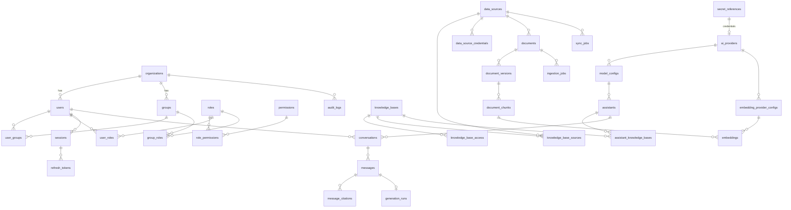

# PlummyKnowledge — Database Schema

| | |
|---|---|
| Статус | Draft v0.1 (до первой миграции) |
| Источник | [PROJECT_BLUEPRINT.md](PROJECT_BLUEPRINT.md) §5, §6, §7, §8, §9, §12, §20 |
| СУБД | PostgreSQL + pgvector (§3) |
| Миграции | Alembic (§3) |
| Решения | [ADR-004](adr/0004-tenant-isolation-and-kb-level-access.md), [ADR-005](adr/0005-assistant-access-model.md), [ADR-006](adr/0006-initial-setup-and-system-configuration.md), [ADR-008](adr/0008-unified-document-ingestion.md) |
| Связанные документы | [ARCHITECTURE.md](ARCHITECTURE.md), [API_CONTRACTS.md](API_CONTRACTS.md), [SECURITY_MODEL.md](SECURITY_MODEL.md) |

**Как читать.** Состав сущностей и общие правила (§9) нормативны. Колонки, типы, enum-значения и индексы —
**рабочий проект**: они выведены из требований blueprint и уточняются в Фазах 2–10. Пункты **[Proposed]**
требуют подтверждения; изменение tenant model или DB — только через ADR (§15). Элементы, закреплённые Accepted ADR,
помечены ссылкой на ADR.

---

## 1. Общие соглашения (§9)

| Правило | Реализация |
|---|---|
| Идентификаторы | `id uuid PRIMARY KEY` во всех таблицах (§9). **[Proposed]** UUIDv7 (сортируемые по времени) генерирует приложение. |
| Tenant scope | Каждая tenant-таблица содержит `organization_id uuid NOT NULL`. Исключения: глобальные справочники (`permissions`) и таблицы уровня инсталляции. |
| Tenant-aware constraints | Каждая tenant-таблица имеет `UNIQUE (organization_id, id)`; внешние ключи между tenant-таблицами — **составные** `(organization_id, <fk>) REFERENCES parent(organization_id, id)`. Это не позволяет на уровне БД связать объекты разных организаций (§9). |
| Foreign keys | Обязательны (§9). `ON DELETE` по умолчанию `RESTRICT`; каскад — только для чисто зависимых связующих таблиц. Удаление данных идёт через lifecycle-jobs, а не каскады. |
| Индексы | По `organization_id`, `status`, `source_id` (`data_source_id`), `document_id`, timestamps (§9). |
| External IDs | Unique в пределах source: `UNIQUE (data_source_id, external_id)` (§9). |
| Timestamps | `created_at timestamptz NOT NULL DEFAULT now()`, `updated_at timestamptz NOT NULL`; все времена — UTC. |
| Soft delete | `deleted_at timestamptz NULL`. Soft delete **не должен** оставлять данные доступными для retrieval (§8 Retention). |
| Enum | **[Proposed]** `text` + `CHECK (... IN (...))` вместо PostgreSQL `ENUM` — проще миграции. |
| Секреты | Хранятся только в `secret_references` в зашифрованном виде; ключ вне БД (§5, §8). Ни одна другая таблица не содержит секретов в открытом виде. |
| Именование | `snake_case`, таблицы во множественном числе; связующие таблицы — `<a>_<b>`. |

### 1.1 Модель tenant **[Proposed — ADR «Tenant membership» (планируется)]**

- `organizations` — tenant.
- Пользователь принадлежит **одной** организации (`users.organization_id`). Email уникален глобально в пределах
  инсталляции, чтобы логин не требовал выбора организации.
- **Platform Owner** (§2) — роль уровня инсталляции (`roles.scope = 'platform'`), назначаемая через `user_roles`.
  Platform Owner управляет организациями и настройками инсталляции, но не получает автоматически доступ к
  документам и диалогам организаций.
- Многочленство пользователя в нескольких организациях — вне MVP; потребует таблицы membership и ADR.

## 2. Обзор сущностей (§9)



| Группа (§9) | Таблицы |
|---|---|
| Identity | `organizations`, `users`, `groups`, `user_groups`, `roles`, `permissions`, `role_permissions`, `user_roles`, `group_roles`, `sessions`, `refresh_tokens` |
| AI | `ai_providers`, `embedding_provider_configs`, `model_configs`, `secret_references` |
| Knowledge | `knowledge_bases`, `knowledge_base_access`, `assistants`, `assistant_knowledge_bases`, `data_sources`, `data_source_credentials`, `knowledge_base_sources`, `documents`, `document_versions`, `document_chunks`, `embeddings` |
| Chat | `conversations`, `messages`, `message_citations`, `generation_runs` |
| Jobs / audit | `ingestion_jobs`, `sync_jobs`, `audit_logs`; позднее `usage_events` |
| Система ([ADR-006](adr/0006-initial-setup-and-system-configuration.md)) | `instance_state` |
| Служебные **[Proposed]** | `idempotency_keys` (§10) |

**Термины.** *Document Source* ([ADR-008](adr/0008-unified-document-ingestion.md)) — это сущность `DataSource`
(таблица `data_sources`). *Embedding profile* — сущность `EmbeddingProviderConfig` (таблица
`embedding_provider_configs`). Отдельных таблиц под эти названия нет.

Ниже для краткости не повторяются стандартные колонки: `id`, `organization_id` (если tenant-таблица),
`created_at`, `updated_at`, а также ограничение `UNIQUE (organization_id, id)`.

---

## 3. Система, Identity и настройки

### 3.0 `instance_state` ([ADR-006](adr/0006-initial-setup-and-system-configuration.md))

Единственная строка с системным состоянием инсталляции. Не таблица настроек: Instance Settings в БД **не хранятся**
(они задаются конфигурацией сервера и читаются при старте).

| Колонка | Тип | Описание |
|---|---|---|
| `id` | `smallint` | PK, `CHECK (id = 1)` — синглтон |
| `initialized_at` | `timestamptz` | NULL = инсталляция не настроена. Через API не сбрасывается |
| `initialized_by_user_id` | `uuid` | Первый администратор |
| `bootstrap_token_hash` | `bytea` | Хэш одноразового bootstrap token; открытое значение не хранится |
| `bootstrap_token_expires_at` | `timestamptz` | |
| `bootstrap_token_used_at` | `timestamptz` | Токен погашен |
| `updated_at` | `timestamptz` | |

Строка создаётся миграцией. `POST /setup/initialize` блокирует её (`SELECT … FOR UPDATE`) и выполняет всю
инициализацию в одной транзакции — второй параллельный запрос ждёт блокировку и видит `initialized_at IS NOT NULL`.
Признак «настроено» **не** выводится из количества пользователей.

### 3.1 `organizations`

| Колонка | Тип | Ограничения / описание |
|---|---|---|
| `name` | `text` | NOT NULL |
| `slug` | `text` | NOT NULL, UNIQUE |
| `status` | `text` | `active` \| `suspended`; NOT NULL |
| `settings` | `jsonb` | Organization Settings — типизированная модель `OrganizationSettingsV1` ([ADR-006](adr/0006-initial-setup-and-system-configuration.md)); неизвестные поля отклоняются; без секретов и сетевых параметров |
| `settings_version` | `integer` | Версия схемы настроек для миграции значений |
| `deleted_at` | `timestamptz` | Soft delete |

Не содержит `organization_id` (сама является tenant).

**Organization Settings vs Instance Settings.** Значения организации валидируются при записи против текущих
Instance Settings и при чтении ограничиваются ими (effective value — более строгое). Пример
`OrganizationSettingsV1` **[Proposed — состав полей]**: `display_name`, `default_locale`, `chat_retention_days`
(≤ instance max), `password_min_length` (≥ instance min), `max_output_tokens_cap` (≤ instance cap),
`allowed_provider_types` (⊆ instance-разрешённых).

### 3.2 `users`

| Колонка | Тип | Ограничения / описание |
|---|---|---|
| `email` | `citext` | NOT NULL, UNIQUE (глобально — см. §1.1) |
| `display_name` | `text` | |
| `password_hash` | `text` | Argon2id (§5); NULL для будущих внешних identity (OIDC) |
| `status` | `text` | `active` \| `disabled` \| `invited` |
| `last_login_at` | `timestamptz` | |
| `password_changed_at` | `timestamptz` | Сессии, выданные раньше, отзываются |
| `deleted_at` | `timestamptz` | |

Индексы: `(organization_id, status)`.

### 3.3 `groups`, `user_groups`

`groups`: `name text NOT NULL`, `description text`, `deleted_at`; `UNIQUE (organization_id, lower(name))`.

`user_groups`: `organization_id`, `user_id`, `group_id`, `created_at`; PK `(user_id, group_id)`;
составные FK на `users` и `groups`; индекс `(organization_id, group_id)`.

### 3.4 `roles`, `permissions`, `role_permissions`, `user_roles`, `group_roles`

`permissions` — **глобальный** справочник, заполняется миграцией:

| Колонка | Тип | Описание |
|---|---|---|
| `key` | `text` | UNIQUE, например `kb.manage`; каталог — в [SECURITY_MODEL.md §3](SECURITY_MODEL.md#3-roles-и-permissions) |
| `description` | `text` | |
| `scope` | `text` | `platform` \| `organization` |

Platform-permissions не дают права изменять Instance Settings: есть только `platform.settings.read`
([ADR-006](adr/0006-initial-setup-and-system-configuration.md)).

`roles`:

| Колонка | Тип | Описание |
|---|---|---|
| `organization_id` | `uuid` | **NULL** для системных ролей (Platform Owner, Organization Admin, Knowledge Manager, Member, Auditor) |
| `key` | `text` | Например `org_admin`; два partial unique: `(key) WHERE organization_id IS NULL` и `(organization_id, key) WHERE organization_id IS NOT NULL` |
| `name`, `description` | `text` | |
| `scope` | `text` | `platform` \| `organization` |
| `is_system` | `boolean` | Системные роли нельзя изменить/удалить через API |

`role_permissions`: PK `(role_id, permission_id)`.

`user_roles`: `organization_id`, `user_id`, `role_id`, `granted_by uuid`, `created_at`; PK `(user_id, role_id)`.

`group_roles`: `organization_id`, `group_id`, `role_id`, `granted_by`, `created_at`; PK `(group_id, role_id)`.

Ограничение: роль со `scope = 'platform'` может назначаться только через `user_roles` (проверка в use case и
`CHECK`/trigger **[Proposed]**).

### 3.5 `sessions`, `refresh_tokens` (§5, §13 Фаза 3)

`sessions`:

| Колонка | Тип | Описание |
|---|---|---|
| `user_id` | `uuid` | FK |
| `expires_at` | `timestamptz` | Абсолютный срок жизни сессии |
| `last_seen_at` | `timestamptz` | |
| `revoked_at` | `timestamptz` | NULL = активна |
| `revoke_reason` | `text` | `logout` \| `admin` \| `password_change` \| `refresh_reuse` \| `user_disabled` |
| `user_agent` | `text` | Усечённый |
| `ip_address` | `inet` | Персональные данные — retention по политике (SECURITY_MODEL.md) |

Индексы: `(organization_id, user_id)`, `(user_id) WHERE revoked_at IS NULL`.

`refresh_tokens` (rotation с reuse detection):

| Колонка | Тип | Описание |
|---|---|---|
| `session_id` | `uuid` | FK |
| `token_hash` | `bytea` | SHA-256 от токена; сам токен не хранится. UNIQUE |
| `issued_at`, `expires_at` | `timestamptz` | |
| `used_at` | `timestamptz` | Момент ротации |
| `replaced_by_id` | `uuid` | Следующий токен в цепочке |
| `revoked_at` | `timestamptz` | |

Повторное предъявление уже использованного refresh token → отзыв всей сессии (`revoke_reason = 'refresh_reuse'`)
и audit event.

---

## 4. AI

### 4.1 `secret_references` (§5, §8)

| Колонка | Тип | Описание |
|---|---|---|
| `kind` | `text` | `ai_api_key` \| `oauth_refresh_token` \| `oauth_client_secret` \| … |
| `backend` | `text` | `db_encrypted` в MVP; поле оставляет место для внешнего vault позднее |
| `ciphertext` | `bytea` | Зашифрованное значение |
| `nonce` | `bytea` | |
| `key_id` | `text` | Версия ключа шифрования (для ротации) |
| `algorithm` | `text` | Например `AES-256-GCM` (ADR «Шифрование секретов» (планируется)) |
| `fingerprint` | `text` | **[Proposed]** Последние 4 символа/хэш для отображения «•••• abcd»; не позволяет восстановить секрет |
| `rotated_at` | `timestamptz` | |

Правила: значение никогда не возвращается API (§12 «secrets не возвращаются»); `ciphertext` не попадает в логи;
associated data для AEAD включает `organization_id` и `id`, чтобы шифртекст нельзя было «пересадить» в другую
запись **[Proposed]**.

### 4.2 `ai_providers` (§5)

| Колонка | Тип | Описание |
|---|---|---|
| `name` | `text` | NOT NULL; `UNIQUE (organization_id, lower(name))` |
| `provider_type` | `text` | `openai` \| `anthropic` \| `ollama` \| `openai_compatible` |
| `base_url` | `text` | Endpoint; проходит SSRF-валидацию (§8 п.7) |
| `secret_ref_id` | `uuid` | FK `secret_references`, NULL для провайдеров без ключа (Ollama) |
| `settings` | `jsonb` | Timeouts, retry, заголовки без секретов |
| `enabled` | `boolean` | |
| `last_test_at` | `timestamptz` | |
| `last_test_status` | `text` | `ok` \| `failed` |
| `last_test_error` | `text` | Redacted |
| `deleted_at` | `timestamptz` | |

### 4.3 `model_configs` (§5)

| Колонка | Тип | Описание |
|---|---|---|
| `provider_id` | `uuid` | Составной FK |
| `model_id` | `text` | Идентификатор модели у провайдера (§5 «model ID») |
| `display_name` | `text` | |
| `kind` | `text` | `chat` (embedding-модели описываются в `embedding_provider_configs`) |
| `context_window` | `integer` | |
| `max_output_tokens` | `integer` | |
| `default_params` | `jsonb` | temperature и т.п. |
| `capabilities` | `jsonb` | streaming и т.д. |
| `enabled` | `boolean` | |

`UNIQUE (provider_id, model_id)`.

### 4.4 `embedding_provider_configs` — embedding profile (§5, §9)

В API и UI называется **embedding profile** (группа endpoints `embedding-profiles`, §10).

| Колонка | Тип | Описание |
|---|---|---|
| `name` | `text` | `UNIQUE (organization_id, lower(name))` |
| `provider_id` | `uuid` | Составной FK на `ai_providers` |
| `model_id` | `text` | |
| `dimensions` | `integer` | NOT NULL |
| `distance_metric` | `text` | `cosine` \| `inner_product` \| `l2` |
| `normalize` | `boolean` | |
| `max_input_tokens` | `integer` | |
| `status` | `text` | `active` \| `deprecated` \| `retired` |

**Profile неизменяем** в части `provider_id`, `model_id`, `dimensions`, `distance_metric`, `normalize`: смена
модели = новый profile + переиндексация (§5). Изменять можно только `name` и `status`.

---

## 5. Knowledge

### 5.1 `knowledge_bases` (§5)

| Колонка | Тип | Описание |
|---|---|---|
| `name` | `text` | `UNIQUE (organization_id, lower(name)) WHERE deleted_at IS NULL` |
| `description` | `text` | |
| `embedding_config_id` | `uuid` | Активный embedding profile для индексации KB |
| `chunking_settings` | `jsonb` | **[Proposed]** |
| `deleted_at` | `timestamptz` | |

Статус индексации KB (§5) вычисляется агрегатом по `documents.processing_status` и активным jobs; при
необходимости кэшируется.

### 5.2 `knowledge_base_access` (§5, §8 Document ACL)

| Колонка | Тип | Описание |
|---|---|---|
| `knowledge_base_id` | `uuid` | Составной FK |
| `principal_type` | `text` | `user` \| `group` |
| `user_id` | `uuid` | NULL, если `principal_type = 'group'` |
| `group_id` | `uuid` | NULL, если `principal_type = 'user'` |
| `access_level` | `text` | `read` (поиск и чат) \| `manage` (документы, источники, sync) |
| `granted_by` | `uuid` | |

`CHECK ((principal_type = 'user') = (user_id IS NOT NULL) AND (principal_type = 'group') = (group_id IS NOT NULL))`;
`UNIQUE (knowledge_base_id, user_id)`, `UNIQUE (knowledge_base_id, group_id)`.

MVP: доступ только на уровне KB; document-level ACL отсутствует (§8).

### 5.3 `assistants`, `assistant_knowledge_bases` (§5)

`assistants`:

| Колонка | Тип | Описание |
|---|---|---|
| `name`, `description` | `text` | |
| `instructions` | `text` | System instructions; не должны содержать секретов (§8) |
| `model_config_id` | `uuid` | LLM |
| `embedding_config_id` | `uuid` | Embedding profile; должен совпадать с `embedding_config_id` каждой привязанной KB (проверка в use case) **[Proposed]** |
| `retrieval_settings` | `jsonb` | top-k (vector/FTS/итоговый), RRF k, dedup, min score |
| `max_context_tokens` | `integer` | Context budget (§6) |
| `max_history_messages` | `integer` | Context limits (§5) |
| `max_output_tokens` | `integer` | |
| `status` | `text` | `active` \| `disabled` |
| `created_by` | `uuid` | |
| `deleted_at` | `timestamptz` | |

`assistant_knowledge_bases`: `organization_id`, `assistant_id`, `knowledge_base_id`; PK
`(assistant_id, knowledge_base_id)`.

**Доступ к ассистенту — [ADR-005](adr/0005-assistant-access-model.md).** Отдельной таблицы доступа нет: доступ
наследуется от KB ассистента.

- Пользователь может использовать ассистента, если имеет эффективный доступ `read` или выше **ко всем** KB из
  `assistant_knowledge_bases` (прямой, через группу, через `knowledge_bases.manage`).
- Ассистент без KB доступен только пользователям с `assistants.manage` (предпросмотр); `disabled` — никому.
- Проверка — на каждом запросе; кэш только в пределах запроса.

Эскиз проверки **[Proposed]**:

```sql
SELECT NOT EXISTS (
  SELECT 1 FROM assistant_knowledge_bases akb
  WHERE akb.organization_id = :org_id AND akb.assistant_id = :assistant_id
    AND NOT EXISTS (                                   -- нет эффективного доступа к этой KB
      SELECT 1 FROM knowledge_base_access a
      LEFT JOIN user_groups ug ON ug.group_id = a.group_id AND ug.user_id = :user_id
      WHERE a.organization_id = :org_id AND a.knowledge_base_id = akb.knowledge_base_id
        AND (a.user_id = :user_id OR ug.user_id IS NOT NULL))
    AND NOT :has_kb_manage_all                         -- knowledge_bases.manage даёт доступ ко всем KB
) AND EXISTS (SELECT 1 FROM assistant_knowledge_bases
             WHERE organization_id = :org_id AND assistant_id = :assistant_id);
```

При удалении KB её строки в `assistant_knowledge_bases` удаляются (связующая таблица, `ON DELETE CASCADE` допустим);
ассистент без KB становится недоступен обычным пользователям.

### 5.4 `data_sources` (§7)

| Колонка | Тип | Описание |
|---|---|---|
| `type` | `text` | `upload` \| `google_drive` \| `microsoft_365` ([ADR-008](adr/0008-unified-document-ingestion.md)); список расширяемый |
| `owner_knowledge_base_id` | `uuid` | Только для `upload`: KB, которой принадлежит источник. `CHECK ((type = 'upload') = (owner_knowledge_base_id IS NOT NULL))`, `UNIQUE (owner_knowledge_base_id)` **[Proposed — имя колонки]** |
| `name` | `text` | |
| `status` | `text` | `active` \| `paused` \| `error` \| `disconnected` |
| `config` | `jsonb` | Выбранная папка / site / drive / library (без секретов) |
| `sync_cursor` | `text` | Google page token / Graph delta link (§7). Обновляется только после успешного checkpoint |
| `sync_schedule` | `text` | Интервал/cron; NULL — только ручной запуск |
| `last_sync_at`, `last_reconciled_at` | `timestamptz` | |
| `last_sync_status` | `text` | |
| `last_error` | `text` | Redacted |
| `created_by` | `uuid` | |
| `deleted_at` | `timestamptz` | |

Локальная загрузка тоже является источником ([ADR-008](adr/0008-unified-document-ingestion.md)): при создании KB
автоматически создаётся `data_sources(type='upload')` и связь в `knowledge_base_sources`. Upload-источник нельзя
подключить к другой KB, создать или удалить через API отдельно — он живёт и удаляется вместе со своей KB. Это сохраняет
KB-level доступ (ADR-004), обеспечивает один ingestion pipeline (§22 п.3) и единое правило
`UNIQUE (data_source_id, external_id)`. Для `upload` `external_id` генерирует сервер; credentials и cursor не
используются.

**Правила удаления источника:** `deleted_at` → все документы источника проходят lifecycle удаления документа (§8);
credentials удаляются немедленно; строки `knowledge_base_sources` удаляются; физическое удаление строки источника —
после purge его документов.

### 5.5 `data_source_credentials` (§7, §8)

| Колонка | Тип | Описание |
|---|---|---|
| `data_source_id` | `uuid` | Составной FK |
| `secret_ref_id` | `uuid` | Зашифрованный refresh token (§13 Фаза 9) |
| `account_label` | `text` | Учётная запись/tenant у провайдера (персональные данные) |
| `granted_scopes` | `text[]` | Фактически выданные scopes — для честного отображения (§7) |
| `status` | `text` | `valid` \| `expired` \| `revoked` |
| `expires_at`, `last_refreshed_at`, `revoked_at` | `timestamptz` | |

### 5.6 `knowledge_base_sources` (§5)

`organization_id`, `knowledge_base_id`, `data_source_id`, `created_at`; PK `(knowledge_base_id, data_source_id)`;
индекс `(organization_id, data_source_id)`.

### 5.7 `documents` (§5)

| Колонка | Тип | Описание |
|---|---|---|
| `data_source_id` | `uuid` | Source ID (§5) |
| `external_id` | `text` | ID файла в источнике; для upload — генерируется сервером. `UNIQUE (data_source_id, external_id)` (§9) |
| `filename` | `text` | Исходное имя — только для отображения, **никогда** не путь в storage (§12) |
| `mime_type` | `text` | Определённый по содержимому |
| `external_path` | `text` | Путь в источнике (для UI) |
| `external_etag` | `text` | ETag/version в источнике (§7) |
| `current_version_id` | `uuid` | Версия, участвующая в retrieval; FK `document_versions` (deferrable) |
| `processing_status` | `text` | `pending` \| `processing` \| `indexed` \| `failed` \| `skipped` (§5) |
| `source_created_at`, `source_modified_at` | `timestamptz` | Timestamps источника (§5) |
| `source_metadata` | `jsonb` | Metadata оригинального источника (владелец, MIME источника, revision, web URL — только для отображения) ([ADR-008](adr/0008-unified-document-ingestion.md)) |
| `deleted_at` | `timestamptz` | Soft delete → немедленное исключение из retrieval |
| `deletion_reason` | `text` | `user` \| `remote_deleted` \| `out_of_scope` \| `source_deleted` \| `kb_deleted` |
| `purged_at` | `timestamptz` | Производные данные удалены по retention |

Индексы: `(organization_id, data_source_id)`, `(organization_id, processing_status)`,
`(organization_id, deleted_at)`, `(organization_id, updated_at)`.

### 5.8 `document_versions` (§5, §6)

| Колонка | Тип | Описание |
|---|---|---|
| `document_id` | `uuid` | Составной FK |
| `version_number` | `integer` | `UNIQUE (document_id, version_number)` |
| `checksum_sha256` | `bytea` | `UNIQUE (document_id, checksum_sha256)` — идемпотентность ingestion (§6) |
| `mime_type` | `text` | |
| `size_bytes` | `bigint` | |
| `page_count` | `integer` | |
| `storage_key` | `text` | Ключ оригинала (сгенерирован сервером) |
| `extracted_storage_key` | `text` | Нормализованная структура / extracted text |
| `external_version` | `text` | ETag/revision источника |
| `parser` | `text` | Например `docling@<version>` |
| `status` | `text` | `pending` \| `processing` \| `ready` \| `failed` \| `outdated` \| `deleted` |
| `error_code` | `text` | |
| `error_message` | `text` | Redacted, без содержимого документа |
| `metadata` | `jsonb` | Извлечённые metadata (§6 шаг 5) |
| `active_chunk_set` | `integer` | Набор chunks, участвующий в retrieval ([ADR-008](adr/0008-unified-document-ingestion.md)) **[Proposed — имя]** |
| `processed_at` | `timestamptz` | |

Версия **неизменяема** по контенту (`checksum_sha256`, `storage_key`); меняются только статус и результат обработки.
Повторная загрузка того же контента в документ возвращает существующую версию.

Индексы: `(organization_id, status)`, `(document_id, status)`.

### 5.9 `document_chunks` (§6)

| Колонка | Тип | Описание |
|---|---|---|
| `document_id` | `uuid` | Денормализация для фильтров/удаления |
| `document_version_id` | `uuid` | Составной FK |
| `data_source_id` | `uuid` | Денормализация для фильтра по KB |
| `chunk_set` | `integer` | Номер набора chunks версии; новый набор строится при смене chunking settings ([ADR-008](adr/0008-unified-document-ingestion.md)) **[Proposed — имя]** |
| `chunk_index` | `integer` | `UNIQUE (document_version_id, chunk_set, chunk_index)` — повтор job не дублирует chunks (§12) |
| `content` | `text` | |
| `content_hash` | `bytea` | Для дедупликации (§6) |
| `token_count` | `integer` | Для context budget |
| `page_start`, `page_end` | `integer` | |
| `section_path` | `text[]` | Иерархия заголовков |
| `sheet_name` | `text` | XLSX |
| `row_start`, `row_end` | `integer` | XLSX/CSV |
| `search_vector` | `tsvector` | `GENERATED ALWAYS AS (to_tsvector(<config>, content)) STORED`; конфигурация — открытый вопрос |

Индексы: `GIN (search_vector)`, `(organization_id, document_version_id)`, `(organization_id, data_source_id)`.

### 5.10 `embeddings` (§6, §9)

| Колонка | Тип | Описание |
|---|---|---|
| `chunk_id` | `uuid` | Составной FK |
| `embedding_config_id` | `uuid` | **Обязателен** — каждая vector row связана с embedding profile (§9) |
| `document_version_id` | `uuid` | Денормализация |
| `data_source_id` | `uuid` | Денормализация |
| `embedding` | `vector` | Размерность = `embedding_provider_configs.dimensions` |

`UNIQUE (chunk_id, embedding_config_id)`.

**[Proposed — ADR «Хранение векторов» (планируется)] Разные размерности.** HNSW-индекс pgvector требует фиксированной размерности. Вариант
по умолчанию: столбец `vector` без размерности и **partial expression index на каждый profile**:

```sql
CREATE INDEX CONCURRENTLY embeddings_hnsw_<profile>
  ON embeddings USING hnsw ((embedding::vector(1536)) vector_cosine_ops)
  WHERE embedding_config_id = '<profile-uuid>';
```

Индекс создаётся служебной задачей при активации profile. Альтернатива — отдельная таблица на размерность.
Запрос обязан использовать то же выражение и предикат, что и индекс.

### 5.11 Правила retrieval на уровне данных (§6, §9)

Retrieval-запрос (vector и FTS-ветки) обязан содержать **все** условия:

```sql
WHERE c.organization_id = :org_id                       -- tenant (из сессии)
  AND c.data_source_id = ANY(:allowed_source_ids)       -- источники KB, доступных пользователю и ассистенту
  AND d.deleted_at IS NULL                              -- удалённые документы исключены
  AND d.current_version_id = c.document_version_id     -- только текущая версия
  AND c.chunk_set = v.active_chunk_set                  -- только активный набор chunks
  AND v.status = 'ready'                                -- failed/outdated/deleted исключены
  AND e.embedding_config_id = :profile_id               -- (vector-ветка) profile ассистента
```

`allowed_source_ids` вычисляется policy service до запроса (§8 п.2): источники KB ассистента ∩ источники KB,
доступных пользователю ([ADR-005](adr/0005-assistant-access-model.md)). Значения от клиента в расчёте не участвуют. **[Proposed — ADR «PostgreSQL RLS» (планируется)]** PostgreSQL Row
Level Security по `organization_id` как второй рубеж.

---

## 6. Chat (§5)

### 6.1 `conversations`

| Колонка | Тип | Описание |
|---|---|---|
| `user_id` | `uuid` | Владелец; диалоги приватны для пользователя |
| `assistant_id` | `uuid` | |
| `title` | `text` | |
| `last_message_at` | `timestamptz` | |
| `deleted_at` | `timestamptz` | |

Индексы: `(organization_id, user_id, last_message_at DESC)`.

### 6.2 `messages`

| Колонка | Тип | Описание |
|---|---|---|
| `conversation_id` | `uuid` | Составной FK |
| `sequence` | `integer` | `UNIQUE (conversation_id, sequence)` |
| `role` | `text` | `user` \| `assistant` |
| `content` | `text` | |
| `status` | `text` | `completed` \| `streaming` \| `stopped` \| `failed` |
| `client_message_id` | `uuid` | Idempotency отправки; `UNIQUE (conversation_id, client_message_id)` **[Proposed]** |

### 6.3 `message_citations` (§6)

Snapshot metadata на момент ответа, чтобы история оставалась читаемой.

| Колонка | Тип | Описание |
|---|---|---|
| `message_id` | `uuid` | Составной FK |
| `citation_key` | `text` | Временный citation ID, выданный backend в этой генерации |
| `ordinal` | `integer` | Порядок отображения |
| `document_id`, `document_version_id`, `chunk_id` | `uuid` | |
| `filename` | `text` | |
| `page`, `section`, `sheet`, `row` | — | `integer` / `text` / `text` / `integer` |
| `snippet` | `text` | |
| `viewer_route` | `text` | Internal viewer route (§6) |

`UNIQUE (message_id, citation_key)`. Открытие цитаты из истории **повторно проверяет** доступ и то, что документ не
удалён (см. SECURITY_MODEL.md); snapshot не даёт прав.

### 6.4 `generation_runs` (§9, §11)

| Колонка | Тип | Описание |
|---|---|---|
| `conversation_id`, `message_id` | `uuid` | |
| `assistant_id`, `model_config_id`, `embedding_config_id` | `uuid` | Конфигурация на момент генерации |
| `status` | `text` | `running` \| `completed` \| `stopped` \| `failed` |
| `finish_reason` | `text` | `stop` \| `length` \| `user_cancelled` \| `error` |
| `retrieved_chunk_ids` | `uuid[]` | Для диагностики и аудита; без текста |
| `rejected_citation_count` | `integer` | Сколько выдуманных citation IDs отклонено (§12) |
| `prompt_tokens`, `completion_tokens` | `integer` | |
| `retrieval_ms`, `time_to_first_token_ms`, `total_ms` | `integer` | Метрики §11 |
| `error_code` | `text` | |
| `started_at`, `finished_at` | `timestamptz` | |

Полный текст prompt **не хранится** (§11: приватные prompts не пишутся в обычные логи).

---

## 7. Jobs и audit

### 7.1 `ingestion_jobs` (§6, §11)

| Колонка | Тип | Описание |
|---|---|---|
| `document_id` | `uuid` | |
| `document_version_id` | `uuid` | NULL до шага 5 |
| `kind` | `text` | `ingest` \| `reindex` \| `delete` \| `purge` |
| `status` | `text` | `queued` \| `running` \| `succeeded` \| `failed` \| `cancelled` \| `dead` |
| `stage` | `text` | Стадия pipeline ([ADR-008](adr/0008-unified-document-ingestion.md)): `fetch`, `authorize`, `validate_type`, `security_check`, `store_original`, `parse`, `normalize`, `chunk`, `embed`, `persist`, `finalize`, `report` |
| `idempotency_key` | `text` | `UNIQUE (organization_id, idempotency_key)`; состав: версия (или элемент источника) + `kind` + хэш chunking settings + embedding profile |
| `result` | `text` | `processed` \| `skipped_already_processed` \| `skipped_unchanged` — для наблюдаемости идемпотентных повторов |
| `attempt`, `max_attempts` | `integer` | |
| `celery_task_id` | `text` | |
| `error_code`, `error_message` | `text` | Redacted |
| `progress` | `jsonb` | Счётчики |
| `requested_by` | `uuid` | NULL для системных |
| `queued_at`, `started_at`, `finished_at` | `timestamptz` | |

Индексы: `(organization_id, status)`, `(document_id)`, `(organization_id, queued_at)`.

### 7.2 `sync_jobs` (§7)

| Колонка | Тип | Описание |
|---|---|---|
| `data_source_id` | `uuid` | |
| `trigger` | `text` | `manual` \| `schedule` \| `reconciliation` \| `initial` |
| `mode` | `text` | `initial` \| `incremental` \| `reconciliation` |
| `status` | `text` | Как у `ingestion_jobs` |
| `cursor_before`, `cursor_after` | `text` | Checkpoint |
| `stats` | `jsonb` | added / updated / deleted / skipped / failed |
| `attempt`, `max_attempts` | `integer` | |
| `error_code`, `error_message` | `text` | Redacted |
| `requested_by` | `uuid` | |
| `queued_at`, `started_at`, `finished_at` | `timestamptz` | |

**Lock от параллельного sync (§7):**

```sql
CREATE UNIQUE INDEX sync_jobs_one_active_per_source
  ON sync_jobs (data_source_id) WHERE status IN ('queued', 'running');
```

### 7.3 `audit_logs` (§8 п.9)

| Колонка | Тип | Описание |
|---|---|---|
| `organization_id` | `uuid` | NULL для событий уровня инсталляции |
| `actor_type` | `text` | `user` \| `system` \| `worker` |
| `actor_user_id` | `uuid` | |
| `action` | `text` | Например `kb.access.granted`; каталог — SECURITY_MODEL.md |
| `target_type`, `target_id` | `text`, `uuid` | |
| `outcome` | `text` | `success` \| `denied` \| `failure` |
| `correlation_id` | `text` | |
| `ip_address` | `inet` | |
| `user_agent` | `text` | |
| `details` | `jsonb` | Без секретов, токенов и содержимого документов |
| `created_at` | `timestamptz` | |

Append-only: роль БД приложения не имеет `UPDATE`/`DELETE` на `audit_logs`; удаление — только retention-job под
отдельной ролью **[Proposed]**. Индексы: `(organization_id, created_at DESC)`, `(organization_id, action)`,
`(target_type, target_id)`.

### 7.4 `usage_events` (позднее, §9)

Не входит в MVP. Будет хранить потребление токенов/операций для analytics (§14).

### 7.5 `idempotency_keys` **[Proposed]** (§10)

`organization_id`, `user_id`, `key`, `endpoint`, `request_hash`, `response_status`, `response_body jsonb`,
`expires_at`; `UNIQUE (organization_id, user_id, endpoint, key)`. Альтернатива — Redis с TTL; выбор в ADR «Формат ошибок, пагинация, idempotency» (планируется).

---

## 8. Retention и lifecycle удаления (§8)

Blueprint требует **определить** lifecycle и сроки; конкретные сроки ниже — **[Proposed]** по умолчанию,
настраиваются на уровне инсталляции/организации.

| Класс данных | При удалении объекта | Срок хранения по умолчанию |
|---|---|---|
| Original files | Удаляются purge-job после soft delete документа | Grace period 7 дней, затем удаление |
| Extracted text | Вместе с версией | Как original |
| Document versions | `outdated` хранятся для истории/цитат | Последние N=3 версии, остальные purge |
| Chunks | Исключаются из retrieval немедленно; удаляются purge-job | Вместе с версией |
| Embeddings | Как chunks; при смене profile старые удаляются после переключения | Вместе с версией/profile |
| Chat history | Удаление диалога пользователем → soft delete, purge | Без автоудаления в MVP; настраиваемо |
| Audit logs | Не удаляются пользователем | 1 год |
| Credentials | При disconnect/revoke — немедленное удаление `secret_references` | — |
| Quarantine/temp | Cleanup после обработки или по TTL | 24 часа |
| Источник (`data_sources`) | Документы — lifecycle документа; credentials — сразу | — |
| Неактивные `chunk_set` | Удаляются после переключения на новый набор | Сразу после успешного reindex |
| Bootstrap token | Хэш обнуляется после инициализации; файл с токеном удаляет владелец | — |

Инварианты: soft delete **немедленно** исключает документ из retrieval (§8); deleted docs не находятся (§12, §20).
Влияние backup retention документируется (§8): удалённые данные остаются в резервных копиях до истечения их срока.

## 9. Миграции (§13, §20)

- Alembic; одна ревизия на логическое изменение; ревизии не редактируются после попадания в `main`.
- Первая ревизия: `CREATE EXTENSION IF NOT EXISTS vector; CREATE EXTENSION IF NOT EXISTS citext;`.
- Сид системных `permissions` и системных `roles` — миграцией данных.
- Каждая миграция проверяется на **чистой БД** и на **upgrade path** с предыдущего релиза (§20).
- Тяжёлые индексы (HNSW, GIN) — `CREATE INDEX CONCURRENTLY` в отдельной ревизии.
- Изменение схемы, затрагивающее tenant model, — только после ADR (§15).

## 10. Открытые вопросы

1. Tenant membership: один пользователь — одна организация; глобальная уникальность email (планируемый ADR).
2. Хранение векторов разной размерности (планируемый ADR).
3. FTS-конфигурация для русского/английского контента.
4. Idempotency keys: PostgreSQL или Redis (планируемый ADR).
5. RLS как второй рубеж (планируемый ADR).
6. Конкретные сроки retention и политика для chat history.
7. Состав полей `OrganizationSettingsV1` и соответствующих instance-границ.

Решено: доступ к ассистентам ([ADR-005](adr/0005-assistant-access-model.md)), хранение настроек и состояние setup
([ADR-006](adr/0006-initial-setup-and-system-configuration.md)), Document Source и разделение
источник/документ/версия/результат ([ADR-008](adr/0008-unified-document-ingestion.md)).
