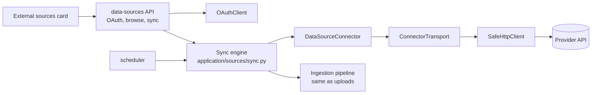

# Developing connectors

This guide is for contributors who add a new document source (another cloud drive, a wiki, a document
management system). Connectors are internal interfaces of this repository, not a plugin API
([ADR-025](../adr/0025-semver-and-contract-stability.md)).

**Start with an ADR.** A new source adds a source type to the public API, a new OAuth integration and new
outbound traffic. Propose it as an ADR first, as [ADR-020](../adr/0020-google-drive-connector.md) (Google Drive)
and [ADR-021](../adr/0021-microsoft-365-connector.md) (Microsoft 365) did: scopes and the least-privilege account,
token storage and revocation, change tracking, limits, and what happens to deleted or moved files.

## How connectors fit in

The connector only **reads** the provider. Everything else is shared with uploads: one ingestion pipeline for all
sources ([ADR-008](../adr/0008-unified-document-ingestion.md)), the same storage, chunking, embeddings,
retrieval and access control by knowledge base.

Ports — `apps/backend/src/plummy/application/sources/ports.py`:

| Port | Responsibility |
|---|---|
| `OAuthClient` | Authorization Code with PKCE (S256): authorization URL, code exchange, refresh, revoke, required scopes, an account label for the UI |
| `DataSourceConnector` | With an access token from the caller: `browse` folders, `get_item`, `list_children`, `start_cursor` and `get_changes` for incremental sync, `download` with a size limit; `capabilities()` |
| `ConnectorError` subclasses | Typed failures: `connector_auth_revoked`, `connector_rate_limited`, `connector_unavailable`, `connector_cursor_invalid`, `connector_file_too_large`, `egress_denied` and others |

The sync engine does the rest: initial listing, incremental changes from the saved cursor, daily reconciliation,
retries, checkpoints after each page, creating document versions only when `RemoteItem.revision` changes,
and removing documents that left the chosen folder.

## Rules a connector must follow

- **Read-only, least privilege.** Request only read scopes. Document that the token sees everything the signed-in
  account sees, whatever folder is chosen, and recommend a dedicated service account.
- **Tokens.** Only the refresh token is stored, encrypted by the vault; access tokens live in memory for one
  operation. Tokens never reach logs, errors, audit records or the frontend.
- **All traffic through `SafeHttpClient`** (purpose `CONNECTOR`) via `ConnectorTransport` in `connector_http.py`,
  which handles retries, `Retry-After` and size limits. Provider hosts are fixed in code; replacing them from
  `CONFIG_FILE` is allowed only outside production, for fakes in tests.
- **Untrusted metadata.** File names, MIME types and IDs come from the provider: never use them as storage paths
  or trust them for the file type (the pipeline detects the type by content).
- **Bounded.** Paginate everything, cap page sizes and downloads (`max_bytes`), and stop following shortcuts or
  links that could lead out of the chosen folder (`RemoteKind.SHORTCUT`).
- **`revision` changes exactly when the content does** (a checksum, or a version for exported formats), so
  re-syncs do not create duplicate versions.
- **Typed errors** with safe messages: never a response body, a file name or a token.

## Steps

1. **ADR** (above), accepted before code.
2. **Domain and database:** a value in `DataSourceType` (`apps/backend/src/plummy/domain/knowledge.py`) and a
   migration that extends the `data_sources.type` check constraint.
3. **Settings:** client ID and secret (`*_FILE`) in `core/config.py`, a `*_configured` property, the redirect URI
   `<PUBLIC_URL>/api/v1/data-sources/oauth/callback`, and the section in `GET /system/settings`.
4. **Adapters** in `apps/backend/src/plummy/infrastructure/integrations/sources/`: an `OAuthClient` and a
   `DataSourceConnector` (see `google_drive.py`, `microsoft_graph.py` and their `*_common.py`).
5. **Composition:** register both in `oauth_clients` and `source_connectors` in `composition.py`; an unconfigured
   type is simply absent.
6. **Frontend:** the provider in `apps/frontend/src/features/sources/format.ts` and the connect option in
   `SourcesCard.tsx`.
7. **Contract and docs:** OpenAPI snapshot, `docs/API_CONTRACTS.md`, `docs/DEPLOYMENT.md` (§7), the
   [connectors guide](connectors.md), `CHANGELOG.md`, and the route inventory in
   `apps/backend/tests/route_inventory.py` if routes change.

## Tests

- **Unit tests of the adapters** with a fake HTTP transport (`tests/fake_http.py`), in the style of
  `tests/unit/test_google_drive.py` and `tests/unit/test_microsoft_graph.py`: pagination, change feeds, exports,
  every error mapping, size limits, and that no token or name appears in errors.
- **Integration tests of sync** on real PostgreSQL and Redis with a fake provider (`tests/fake_google.py`,
  `tests/fake_microsoft.py`), like `tests/integration/test_source_sync.py`: initial and incremental sync,
  reconciliation, moves out of the folder, deletions, revoked access, repeated jobs that create no duplicates, and
  that users without access to the knowledge base see nothing.
- **E2E** with a stdlib fake of the provider in `deploy/e2e/` (see `fake_google.py`, `fake_microsoft.py`) for the
  OAuth flow in the browser.

Then run the full checks listed in [CONTRIBUTING.md](../../CONTRIBUTING.md).
