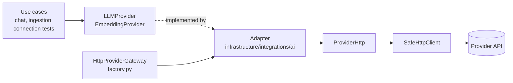

# Developing AI providers

This guide is for contributors who add support for a new LLM or embedding API. Provider adapters are internal
interfaces: they live in this repository and may change in minor releases; they are not a plugin API
([ADR-025](../adr/0025-semver-and-contract-stability.md)).

## Do you need a new provider?

Probably not. Servers with an OpenAI-compatible API (vLLM, LM Studio, llama.cpp server, LocalAI, many hosted
gateways) work with the existing **OpenAI-compatible** type. Add a type only for an API with its own wire format,
as Anthropic and Ollama have.

## How providers fit in



- **Ports** — `apps/backend/src/plummy/application/ai/ports.py`: `LLMProvider` (`capabilities`, `test_connection`,
  `stream_chat`), `EmbeddingProvider` (`embedding_capabilities`, `test_connection`, `embed`), request and event
  types and the typed `ProviderError` hierarchy. Use cases depend on these only.
- **Adapters** — `apps/backend/src/plummy/infrastructure/integrations/ai/`: one module per wire format, built on
  `common.py` (`ProviderHttp` for requests, retries and error mapping; `iter_sse`, `render_context`,
  `measure_connection` and size limits).
- **Factory** — `factory.py` is the only place that maps a `ProviderType` to an adapter class.

No vendor SDKs: adapters speak HTTP through `httpx` wrapped by `SafeHttpClient`, so every connection passes the
instance network policy ([ADR-007](../adr/0007-network-access-and-local-llm.md)).

## Rules an adapter must follow

- **All traffic through `ProviderHttp`/`SafeHttpClient`** with the right `EgressPurpose` (`LLM` for chat and its
  connection test, `EMBEDDING` for embeddings). Never create another HTTP client.
- **Typed errors only.** Map HTTP statuses and transport failures with `error_for_status` and
  `error_for_exception`. Messages are fixed text: never put a response body, an API key, a prompt or document text
  into an error or a log line.
- **Streaming contract.** `stream_chat` yields `TextDelta` events and then exactly one `Finished`; a stream that ends
  without its final event is `ProviderInvalidResponseError`. Retries happen only before the first byte of a
  stream.
- **Cancellation.** Honour `CancellationToken`: wrap waits with `race` and stop reading promptly.
- **Untrusted context.** Retrieved passages are data, not instructions: pass them with `render_context` (or the
  provider's equivalent) separate from `request.instructions`, keeping their citation IDs.
- **No tools.** Models get no tools or function calling without a separate architecture decision.
- **Bounded responses.** Respect `MAX_JSON_RESPONSE_BYTES`, `MAX_STREAM_BYTES` and
  `MAX_EMBEDDING_RESPONSE_BYTES`; validate shapes (`vectors`, `model_ids`) instead of trusting them.
- **`test_connection` never raises**: it returns `ConnectionTestResult(ok=False, error=…)`.

## Steps

1. **Domain:** add the value to `ProviderType` in `apps/backend/src/plummy/domain/ai.py`; add it to
   `KEY_REQUIRED` if the API always needs a key and to `EMBEDDING_CAPABLE` if it has embeddings.
2. **Database:** an Alembic migration that extends the `provider_type` check constraint of `ai_providers`
   (`cd apps/backend && uv run alembic revision -m "…"`), and the same constraint in
   `infrastructure/db/models.py`.
3. **Adapter:** a module in `infrastructure/integrations/ai/`, using `ollama.py` as the smallest example. Add a
   default base URL in `factory.py` only for a public cloud API.
4. **Factory:** add the type to `build_llm_provider` and `build_embedding_provider` (raise
   `UnsupportedCapabilityError` if there are no embeddings). The `match` must stay exhaustive: mypy checks it.
5. **Frontend:** add the type to `PROVIDER_TYPES` (and `EMBEDDING_PROVIDER_TYPES`) in
   `apps/frontend/src/features/providers/providersApi.ts`.
6. **Contract:** the new enum value appears in the OpenAPI schema. Update the snapshot, `docs/API_CONTRACTS.md`
   (provider types) and `CHANGELOG.md` (`Added`). A new value is a compatible change.
7. **Docs:** `docs/ARCHITECTURE.md` (§8) and, for local servers, the [local models guide](local-models.md).

## Tests

- **Contract tests** in `apps/backend/tests/contract/test_ai_providers.py` run each adapter against a local fake
  server that speaks the vendor's wire format over real sockets, through `SafeHttpClient` with a loopback allowlist
  entry. Cover at least: connection test (success and each failure type), streamed chat with usage and finish
  reasons, errors before and inside a stream, retries and their bounds, cancellation, a stalled stream, malformed
  and truncated responses, embeddings batching and order, and that provider text never appears in errors.
- **Live tests** (`tests/contract/test_ai_providers_live.py`, marker `live`) call the real API with your own key.
  They cost tokens and never run in CI:

  ```bash
  cd apps/backend && LIVE_PROVIDER_TESTS=1 <VENDOR>_API_KEY=… uv run pytest -m live
  ```

- Update the OpenAPI snapshot:

  ```bash
  docker compose run --rm --no-deps -v "$PWD/apps/backend:/work" -w /work -e UPDATE_OPENAPI_SNAPSHOT=1 \
    backend pytest tests/contract/test_openapi_snapshot.py
  ```

Then run the full checks listed in [CONTRIBUTING.md](../../CONTRIBUTING.md).
